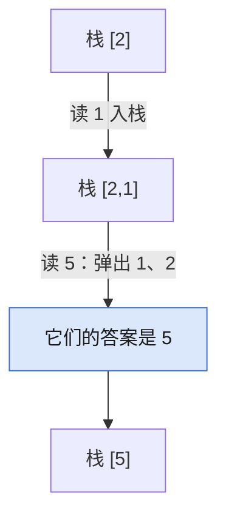

## Q
**LC 1019 链表中的下一个更大节点**｜Medium

给链表头结点 `head`，对每个结点，返回它后面第一个**值严格更大**的结点的值，没有则为 `0`，按结点顺序组成数组。

## A
**一句话。** 先把链表值读进数组，再用单调栈：栈里放还没找到答案的下标，遇到更大的值就依次弹出并写答案。

**图解。** 链表 `2 → 1 → 5`：读 `2`、`1` 入栈；读 `5` 比栈顶大，弹出 `1`、`2`，它们的答案都是 `5`；`5` 入栈，最后留着的答案为 `0`。



```python
def next_larger_nodes(head):
    vals = []
    while head:
        vals.append(head.val)
        head = head.next
    ans, st = [0] * len(vals), []     # st：还没找到答案的下标
    for i, v in enumerate(vals):
        while st and vals[st[-1]] < v:
            ans[st.pop()] = v         # v 就是它们的下一个更大值
        st.append(i)
    return ans
```

**复杂度。** 时间 `O(n)`，空间 `O(n)`。

**易错点。**
- 弹出条件用 `<=`：相等的值不算更大，会误写答案。
- 栈里存值而不是下标：写答案需要知道位置，必须存下标。
- 链表直接两层循环：`O(n²)`，数据到 `10^4` 会慢。

**追问。**
- 不先转数组行吗？：可以边遍历链表边维护栈，栈里存 `(下标, 值)`，答案数组随结点数扩张。
- 要「下一个更小」怎么改？：把比较方向反过来即可。

**同模式。** LC 496 下一个更大元素 I、LC 739 每日温度、LC 503 下一个更大元素 II
