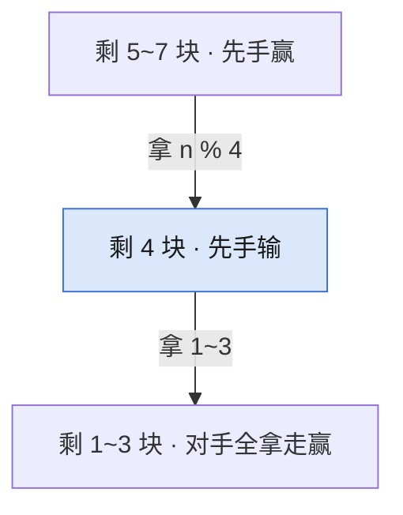

## Q
**LC 292 Nim 游戏**｜Easy

桌上有 `n` 块石头，你和对手轮流拿 1 到 3 块，你先手，拿走最后一块的人赢，双方都用最优策略。判断你能否获胜。

## A
**一句话。** `n` 是 4 的倍数时先手必输，否则先手必赢：先手总能拿走 `n % 4` 块，让对手面对 4 的倍数。

**图解。** 4 的倍数是必败态：无论拿 1、2、3 块，对手都能补成总共 4 块，把你留在更小的 4 的倍数上。



```python
def can_win_nim(n):
    return n % 4 != 0            # 4 的倍数是必败态
```

**复杂度。** 时间 `O(1)`，空间 `O(1)`。

**易错点。**
- 用 DP 递推到 `n`：`n` 很大（`2^31`）时会超时或爆内存，要用规律。
- 把 `n = 0` 当作先手赢：没有石头可拿，先手已经输了（题目保证 `n ≥ 1`，不会遇到）。

**追问。**
- 一次拿 1 到 `m` 块呢？：必败态是 `m + 1` 的倍数，答案 `n % (m + 1) != 0`。
- 多堆石头怎么办？：经典 Nim 游戏用各堆数量的异或值，非零则先手赢。

**同模式。** LC 877 石子游戏、LC 294 翻转游戏 II、LC 1823 找出游戏的获胜者
