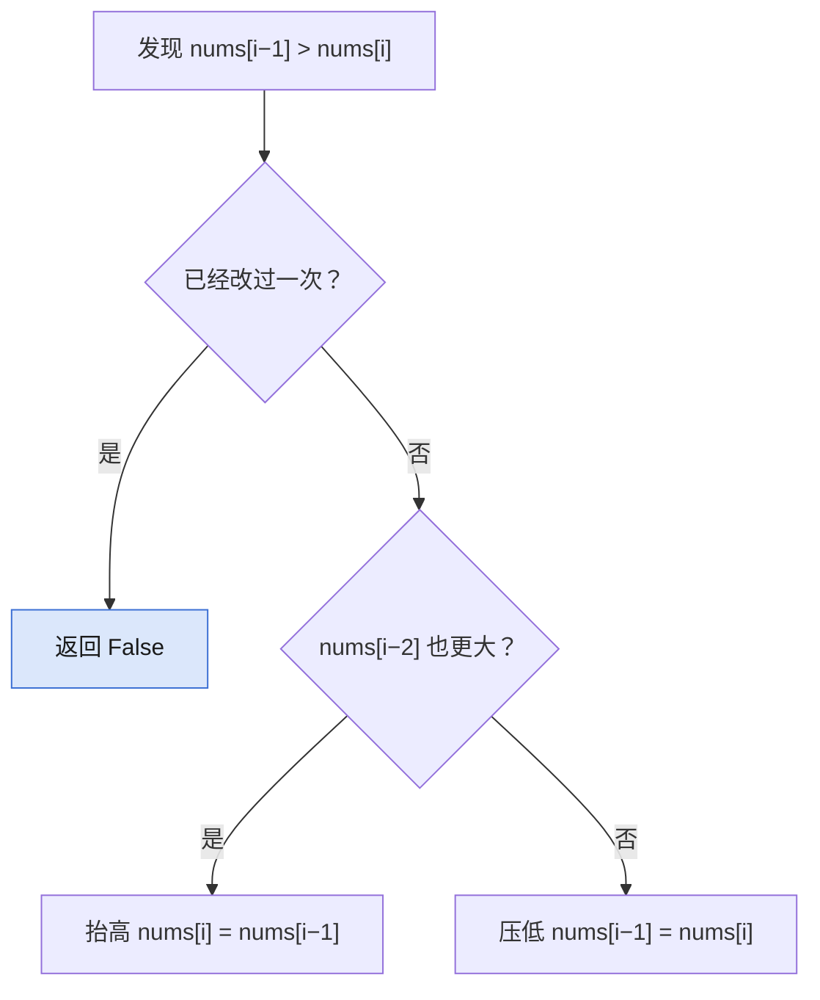

## Q
**LC 665 非递减数列**｜Medium

整数数组 `nums`。最多修改一个元素（改成任意值），能否让数组变成非递减数组？

## A
**一句话。** 遇到第一个下降对 `nums[i - 1] > nums[i]` 就必须修改其中一个：若 `nums[i - 2] > nums[i]`，只能把 `nums[i]` 抬高到 `nums[i - 1]`，否则把 `nums[i - 1]` 压低到 `nums[i]`；第二次遇到下降就失败。

**图解。** 下降发生在 `i - 1` 与 `i` 之间，看 `i - 2` 能否放得下 `nums[i]`，决定改前一个还是后一个。



```python
def check_possibility(nums):
    changed = False
    for i in range(1, len(nums)):
        if nums[i - 1] <= nums[i]:
            continue
        if changed:
            return False         # 第二个下降，没救了
        changed = True
        if i >= 2 and nums[i - 2] > nums[i]:
            nums[i] = nums[i - 1]    # 只能抬高当前这个
        else:
            nums[i - 1] = nums[i]    # 压低前一个，不影响更前面
    return True
```

**复杂度。** 时间 `O(n)`，空间 `O(1)`。

**易错点。**
- 总是压低 `nums[i - 1]`：当 `nums[i - 2] > nums[i]` 时压低会破坏与 `nums[i - 2]` 的顺序，必须抬高 `nums[i]`。
- 只数下降对的个数：两个下降对相隔很远可以只改一个吗？不能，但相邻的下降对可能被同一次修改解决，要靠修改后继续检查。
- 越界访问 `nums[i - 2]`：`i < 2` 时没有这个元素，要先判断。

**追问。**
- 为什么这样改不会更糟？：压低前一个时它不会再比 `nums[i - 2]` 小，抬高当前的时只会比后面可能的元素更大，所以选择能继续成立的那个。
- 如果允许修改 `k` 次？：转化为最长非递减子序列，答案是 `n - 最长长度 ≤ k`。

**同模式。** LC 1827 最少操作使数组递增、LC 2289 使数组按非递减顺序排列、LC 300 最长递增子序列、LC 1095 山脉数组中查找目标值
