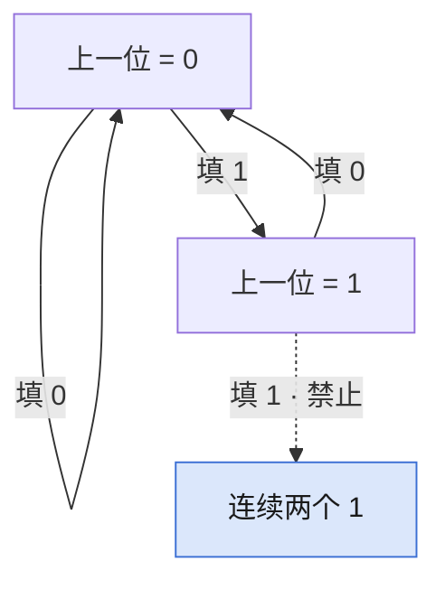

## Q
**LC 600 不含连续1的非负整数**｜Hard

给正整数 `n`，统计 `[0, n]` 中二进制表示里没有连续两个 1 的非负整数个数。

## A
**一句话。** 数位 DP（二进制）：从高位到低位逐位填 0/1，记「上一位是不是 1」和「是否仍被 `n` 的前缀限制」；上一位是 1 时这一位只能填 0。

**图解。** 状态只有「上一位」和「是否限制」；相邻两个 1 的转移被直接剪掉。



```python
def find_integers(n):
    bits = bin(n)[2:]
    L = len(bits)
    @cache
    def f(i, prev, limit):       # prev：上一位是否为 1
        if i == L:
            return 1
        up = int(bits[i]) if limit else 1
        res = 0
        for d in range(up + 1):
            if prev and d:
                continue         # 不允许连续两个 1
            res += f(i + 1, d, limit and d == up)
        return res
    return f(0, 0, True)
```

**复杂度。** 状态 `O(log n)`，时间 `O(log n)`，空间 `O(log n)`。

**易错点。**
- 没有区分「是否受限」：不受限时每位都可以填 0 或 1，但超过 `n` 的数不能算进去。
- 把 0 漏掉：`0` 的各位都是 0，没有连续 1，是合法的，递归到末尾返回 1 就已经包含它。
- 前导零的处理：二进制里前导零不影响「是否连续 1」，不需要 `started` 标志。

**追问。**
- 不限制上界怎么算？：`g(L)` 满足斐波那契递推 `g(L) = g(L - 1) + g(L - 2)`，所以答案与斐波那契数有关。
- 能不用记忆化吗？：沿 `n` 的每一个 1 位累加斐波那契数，遇到连续两个 1 就停止，`O(log n)`。

**同模式。** LC 2376 统计特殊整数、LC 233 数字 1 的个数、LC 357 统计各位数字都不同的数字个数、LC 509 斐波那契数
