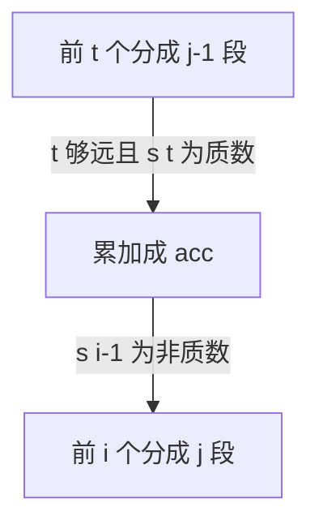

## Q
**LC 2478 完美分割的方案数**｜Hard

数字字符串 `s`，整数 `k` 和 `minLength`。一个分割是"完美"的当且仅当：恰好分成 `k` 个子串，每个子串长度至少 `minLength`，且每个子串以质数数字（`2 3 5 7`）开头、以非质数数字结尾。求完美分割的方案数，对 `10^9 + 7` 取模。

## A
**一句话。** `f[j][i]` 表示前 `i` 个字符分成 `j` 段的方案数；`f[j][i]` 来自所有满足 `t <= i - minLength` 且 `s[t]` 为质数的 `f[j-1][t]` 之和，用前缀和滚动累加。



```python
def beautiful_partitions(s, k, min_length):
    M = 10 ** 9 + 7
    n = len(s)
    prime = lambda c: c in '2357'
    if not prime(s[0]) or prime(s[-1]):
        return 0
    f = [[0] * (n + 1) for _ in range(k + 1)]
    f[0][0] = 1
    for j in range(1, k + 1):
        acc = 0                            # f[j-1][t] 的前缀和
        for i in range(n + 1):
            t = i - min_length             # 最后一段从 t 开始
            if t >= 0 and prime(s[t]):
                acc += f[j - 1][t]
            if i > 0 and not prime(s[i - 1]):   # 最后一段以非质数结尾
                f[j][i] = acc % M
    return f[k][n]
```

**复杂度。** 时间 `O(kn)`，空间 `O(kn)`。

**易错点。**
- 枚举所有切点：`O(kn²)` 超时，用前缀和压掉内层循环。
- 忘了开头和结尾的预判：`s[0]` 不是质数或 `s[-1]` 是质数，必然为 `0`。
- 最后一段起点 `t` 没有判质数：每一段必须以质数开头。

**追问。**
- 空间能压吗？：`f[j]` 只依赖 `f[j-1]`，可以滚动成两行。

**同模式。** LC 1473 粉刷房子 III、LC 1220 统计元音字母序列的数目
