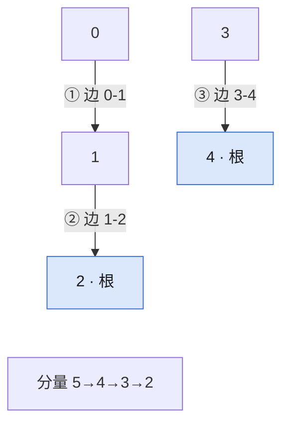

## Q
**LC 323 无向图中连通分量的数目**｜Medium

`n` 个节点的无向图，给出边列表，求连通分量的个数。

## A
**一句话。** 并查集：初始 `n` 个分量，两端的根不同才合并，并让计数减一。

**图解。** 箭头是 `parent` 指针；每条边两端的根不同才合并，分量数减一。



```python
def count_components(n, edges):
    parent = list(range(n))

    def find(x):
        while parent[x] != x:
            parent[x] = parent[parent[x]]   # 路径减半
            x = parent[x]
        return x

    comps = n
    for a, b in edges:
        ra, rb = find(a), find(b)
        if ra != rb:                 # 本来不连通
            parent[ra] = rb
            comps -= 1
    return comps
```

**复杂度。** 时间 `O((n+m) α(n))`，空间 `O(n)`。

**易错点。**
- 用 `n - len(edges)`：有环时错，`[[0,1],[1,2],[0,2],[3,4]]` 得 `1`，应为 `2`。
- 比较端点而不比较根：每条边都当成一次成功合并。
- 递归写 `find` 且不压缩路径：链状数据超过递归上限 `1000`。

**追问。**
- 边动态加入、每次返回分量数？：并查集本身在线，每次 `O(α(n))`，DFS 要整图重算。
- 判断是不是一棵树（LC 261）？：合并时遇到同根说明有环，且最终分量数必须是 `1`。

**同模式。** LC 547 省份数量、LC 261 以图判树、LC 684 冗余连接、LC 721 账户合并
