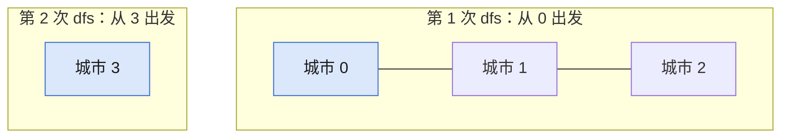

## Q
**LC 547 省份数量**｜Medium

`n x n` 矩阵 `isConnected[i][j] = 1` 表示城市 `i`、`j` 直接相连（可传递）。求相连城市组成的省份数。

## A
**一句话。** 求连通分量个数：对每个未访问的城市做一次递归 DFS，启动次数就是省份数。

**图解。** 每次从未访问的城市启动 DFS，会走完整个连通块；启动 2 次就是 2 个省份。



```python
def find_circle_num(is_connected):
    n = len(is_connected)
    seen = [False] * n

    def dfs(i):
        seen[i] = True               # 先标记再递归
        for j in range(n):
            if is_connected[i][j] and not seen[j]:
                dfs(j)

    res = 0
    for i in range(n):
        if not seen[i]:
            dfs(i)
            res += 1
    return res
```

**复杂度。** 时间 `O(n²)`，空间 `O(n)`。

**易错点。**
- 当网格做上下左右 DFS：`[[1,0,1],[0,1,0],[1,0,1]]` 得 `5`，应为 `2`；邻居是第 `i` 行里为 `1` 的城市。
- 先递归后标记 `seen`：`is_connected[0][0] == 1`，`dfs(0)` 无限递归，`[[1]]` 都会崩。

**追问。**
- 边在线到来，每来一条边问当前省份数？：并查集，每条边 `O(α(n))`。
- 不想递归怎么办？：显式栈，入栈时就标记，每个城市只入栈一次。

**同模式。** LC 200 岛屿数量、LC 323 无向图中连通分量的数目、LC 684 冗余连接、LC 721 账户合并
