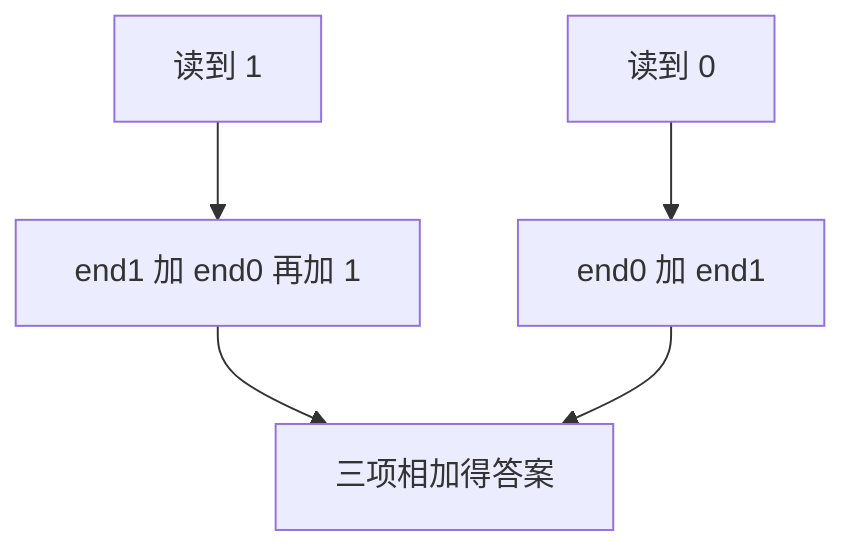

## Q
**LC 1987 不同的好子序列数目**｜Hard

二进制字符串 `binary`。"好"子序列是非空、没有前导零的子序列（`"0"` 本身也算好）。求**不同**的好子序列个数，对 `10^9 + 7` 取模。

## A
**一句话。** 按结尾字符分类计数：`end1` 为以 `1` 结尾的好子序列数，`end0` 为以 `0` 结尾且以 `1` 开头的个数；遇到字符就把它接到所有已有子序列后面（并把旧的同结尾计数替换掉去重）。



```python
def number_of_unique_good_subsequences(binary):
    M = 10 ** 9 + 7
    end0 = end1 = 0           # 以 0 / 1 结尾且以 1 开头的不同子序列数
    has0 = 0                  # 单独的 "0"
    for c in binary:
        if c == '1':
            end1 = (end0 + end1 + 1) % M   # +1 是单独的 "1"
        else:
            end0 = (end0 + end1) % M       # 以 0 开头的不算
            has0 = 1
    return (end0 + end1 + has0) % M
```

**复杂度。** 时间 `O(n)`，空间 `O(1)`。

**易错点。**
- 把 `0` 接到空序列后面：会产生前导零的 `"0…"`；`"0"` 只单独算一个，用 `has0`。
- 新值写成 `end1 += end0 + end1 + 1`：不同子序列要用"替换"而不是"累加"，旧的同结尾序列已被新的包含。

**追问。**
- 这是不同子序列的哪个题？：LC 940 "不同的子序列 II" 的二进制特化，去重的思路一样，结尾字符相同时用新值替换旧值。

**同模式。** LC 115 不同的子序列、LC 940 不同的子序列 II、LC 730 统计不同回文子序列
