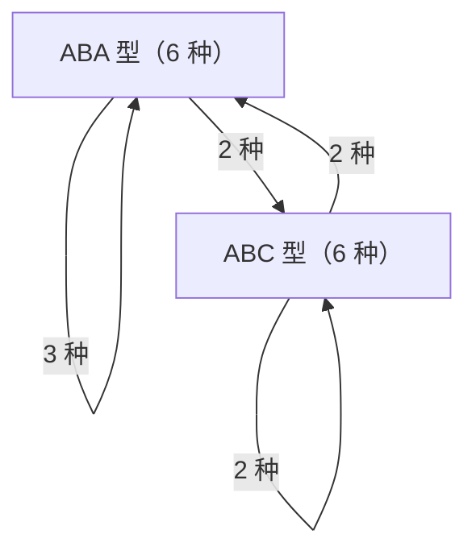

## Q
**LC 1411 给 N x 3 网格图涂色的方案数**｜Hard

`n × 3` 网格用红黄绿三色涂色，上下左右相邻格颜色不同，求方案数，对 `10^9+7` 取余。

## A
**一句话。** 一行只有两类：两端同色的 `ABA`（6 种）和三色全不同的 `ABC`（6 种）；下一行接在 `ABA` 后有 3 种 `ABA`、2 种 `ABC`，接在 `ABC` 后各有 2 种，按两类递推。

**图解。** 箭头上是「一行接一行」的方案数，只要记两类的个数。



```python
def num_of_ways(n):
    MOD = 10**9 + 7
    aba, abc = 6, 6            # 两端同色 / 三色全不同
    for _ in range(n - 1):
        aba, abc = ((3 * aba + 2 * abc) % MOD,
                    (2 * aba + 2 * abc) % MOD)
    return (aba + abc) % MOD
```

**复杂度。** 时间 `O(n)`，空间 `O(1)`。

**易错点。**
- 先算出新的 `aba` 再用它算 `abc`：两者要同时更新，用元组赋值。
- 以为只有 6 种行：`ABA` 型也合法（两端不相邻），一行共 12 种。

**追问。**
- 系数怎么来的？：固定上一行，枚举下一行 12 种里与它每列都不同的，按类型数一遍即可。
- 列数 `m` 变大？：状态是一行的 `3^m` 种合法涂法，做状压 DP，就是 LC 1931。

**同模式。** LC 70 爬楼梯、LC 1931 用三种不同颜色为网格涂色、LC 256 粉刷房子
