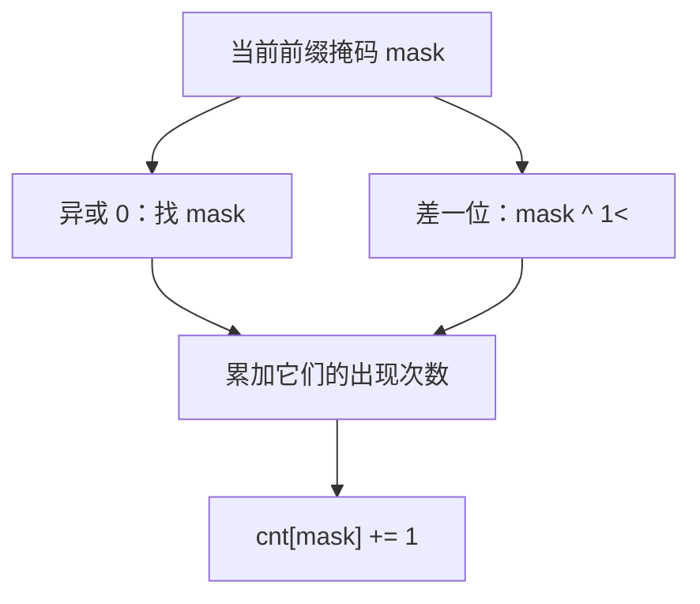

## Q
**LC 1915 最美子字符串的数目**｜Medium

字符串 `word` 只含 `a` 到 `j`。若一个子串里至多一个字母出现奇数次，它就是最美的。求最美的非空子串个数（相同子串按位置分别计数）。

## A
**一句话。** 前缀异或掩码：`mask` 的第 `c` 位记录字母 `c` 出现次数的奇偶，子串的奇偶是两端掩码的异或；异或为 `0` 或只有一位为 `1`，就用计数表统计之前出现过的这样的掩码。

**图解。** 当前掩码要找的前缀掩码：自己（异或为 0），或自己翻转一位（异或只有一位），共 `1 + 10` 种。



```python
def wonderful_substrings(word):
    cnt = [0] * 1024
    cnt[0] = 1                     # 空前缀
    mask = ans = 0
    for c in word:
        mask ^= 1 << (ord(c) - 97)
        ans += cnt[mask]           # 全是偶数次
        for b in range(10):        # 恰有一个奇数次
            ans += cnt[mask ^ (1 << b)]
        cnt[mask] += 1             # 统计完再把自己放进去
    return ans
```

**复杂度。** 时间 `O(10n)`，空间 `O(2^10)`。

**易错点。**
- 忘了 `cnt[0] = 1`：从开头起的子串没有对应的空前缀，会漏算。
- 先 `cnt[mask] += 1` 再统计：会把长度为 0 的空子串也算进去。

**追问。**
- 为什么字母只到 `j`？：掩码 `2^10 = 1024`，数组小；字母更多时可改用哈希表。
- 和「和为 K 的子数组」的关系？：同样是前缀 + 哈希计数，只是前缀值换成奇偶掩码、目标差值换成「至多一位不同」。

**同模式。** LC 560 和为 K 的子数组、LC 1310 子数组异或查询、LC 1457 二叉树中的伪回文路径、LC 2791 树中可以形成回文的路径数
