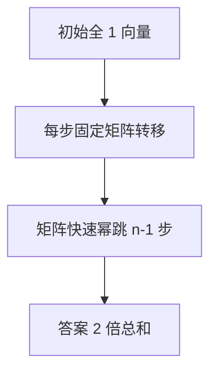

## Q
**LC 3700 锯齿形数组的总数 II**｜Hard

给整数 `n`、`l`、`r`，构造长度为 `n` 的整数数组，元素在 `[l, r]` 内，相邻元素不相等且整个数组"锯齿"（升降交替，每三个相邻元素中间的一个是峰或谷）。求这样的数组数，对 `10^9 + 7` 取模，`n` 最大 `10^9`，`r - l` 不超过 `74`。

## A
**一句话。** 设 `x_k[v]` 为长度 `k` 的数组以 `v` 结尾且最后一步是上升的方案数，下降的方案由镜像对称得到；转移是固定的 `m × m` 矩阵（`m = r - l + 1`），用矩阵快速幂跳到第 `n` 步，答案乘 `2`。



```python
def zig_zag_arrays(n, l, r):
    M = 10 ** 9 + 7
    m = r - l + 1
    # 最后一步为上升，值 v 之前一步是下降且值 u < v；
    # 下降数组镜像后等价于上升，所以只记一个向量
    A = [[1 if w > m - 1 - v else 0 for w in range(m)]
         for v in range(m)]

    def mul(X, Y):
        Yt = list(zip(*Y))
        return [[sum(a * b for a, b in zip(row, col)) % M
                 for col in Yt] for row in X]

    vec = [[1] for _ in range(m)]
    p = n - 1
    while p:
        if p & 1:
            vec = mul(A, vec)
        A = mul(A, A)
        p >>= 1
    return 2 * sum(x[0] for x in vec) % M
```

**复杂度。** 时间 `O(m³ log n)`，空间 `O(m²)`。

**易错点。**
- 按 `n` 做 DP：`n` 到 `10^9`，只能矩阵快速幂。
- 忘了乘 `2`：先升和先降两种起手对称，各占一半。
- 状态同时存升降两个向量：用镜像只存一个，矩阵小一半。

**追问。**
- 为什么能用镜像？：把每个值 `v` 换成 `m-1-v`，上升的数组变成下降的数组，个数相同。

**同模式。** LC 376 摆动序列、LC 629 K 个逆序对数组、LC 3699 锯齿形数组的总数 I
