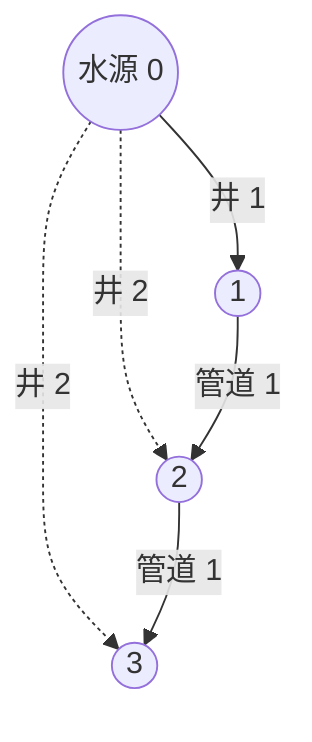

## Q
**LC 1168 水资源分配优化**｜Hard

村里 `n` 座房子，在房子 `i` 打井花 `wells[i-1]`，管道 `pipes[j] = [a, b, c]` 表示连通房子 `a`、`b` 花 `c`。求让每座房子都有水的最小总花费。

## A
**一句话。** 加一个虚拟水源 `0`，「在 `i` 打井」就是一条 `0—i`、权为 `wells[i-1]` 的边，问题变成 `n+1` 个点的最小生成树，用 Kruskal。

**图解。** `wells = [1,2,2]`、管道 `1—2`、`2—3` 各花 1：MST 选 `0—1` 打一口井再接两段管道，共 3。



```python
def min_cost_to_supply_water(n, wells, pipes):
    # 打井 = 连一条到虚拟水源 0 的边
    edges = [(w, 0, i + 1) for i, w in enumerate(wells)]
    edges += [(c, a, b) for a, b, c in pipes]
    parent = list(range(n + 1))
    def find(x):
        while parent[x] != x:
            parent[x] = parent[parent[x]]
            x = parent[x]
        return x
    total = 0
    for w, a, b in sorted(edges):
        ra, rb = find(a), find(b)
        if ra != rb:
            parent[ra] = rb
            total += w
    return total
```

**复杂度。** 时间 `O((n+m) log(n+m))`，空间 `O(n+m)`。

**易错点。**
- 只在房子之间做 MST：至少要打一口井，不加虚拟点就漏了打井的花费。
- 并查集开 `n` 个：房子编号 1 到 `n`，加上水源要开 `n+1`。

**追问。**
- 为什么虚拟点是对的？：每个连通块恰好要一个水源，等价于每块里恰有一条连到 `0` 的边，正是 `0..n` 上的生成树。
- 用 Prim？：从水源 `0` 出发、堆里放 `(花费, 点)`，稠密图更合适。

**同模式。** LC 1584 连接所有点的最小费用、LC 1135 最低成本连通所有城市、LC 1489 找到最小生成树里的关键边和伪关键边
