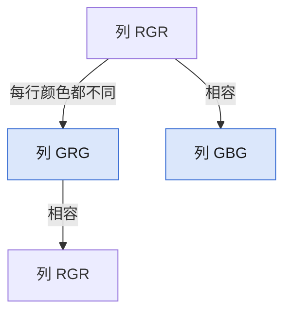

## Q
**LC 1931 用三种不同颜色为网格涂色**｜Hard

`m × n` 的网格（`m ≤ 5`，`n ≤ 1000`），每格涂红、绿、蓝之一，相邻格（上下左右）颜色必须不同。返回涂色方案数，对 `10^9 + 7` 取模。

## A
**一句话。** 按列做 DP：先枚举单列所有合法涂法（竖向不相邻同色，至多 48 种），两列相容当且仅当同一行颜色不同，`dp` 逐列转移。

**图解。** 单列状态是一个长度 `m` 的颜色串，左右两列相容就连一条边，每加一列就沿边累加方案数。



```python
def color_the_grid(m, n):
    MOD = 10 ** 9 + 7
    cols = [c for c in product(range(3), repeat=m)
            if all(c[i] != c[i + 1] for i in range(m - 1))]
    ok = {c: [d for d in cols
              if all(x != y for x, y in zip(c, d))]
          for c in cols}         # 能放在 c 右边的列
    dp = {c: 1 for c in cols}
    for _ in range(n - 1):
        dp = {c: sum(dp[d] for d in ok[c]) % MOD
              for c in cols}
    return sum(dp.values()) % MOD
```

**复杂度。** 时间 `O(S^2 m + n S^2)`（`S ≤ 48` 为单列状态数），空间 `O(S^2)`。

**易错点。**
- 把 `m`、`n` 搞反：状态压缩的是较小的一维，这里是行数 `m ≤ 5`。
- 列内合法性只查与上一格不同：同一列的相邻格必须不同，列间则逐行比较。
- 忘了取模：最后求和也要取模。

**追问。**
- 怎样更快？：状态转移是固定的 `S × S` 矩阵，用矩阵快速幂可做到 `O(S^3 log n)`。
- 与 LC 1411 的关系？：那题 `m = 3` 的特例，状态只有 12 种。

**同模式。** LC 1411 给 N x 3 网格图涂色的方案数、LC 1349 参加考试的最大学生数、LC 935 骑士拨号器、LC 576 出界的路径数
