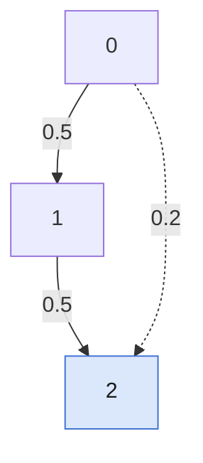

## Q
**LC 1514 概率最大的路径**｜Medium

无向图 `n` 个点，每条边 `edges[i]` 的成功概率为 `succProb[i]`。求从 `start_node` 到 `end_node` 成功概率最大的路径的概率（沿路概率相乘），没有路径返回 `0`。

## A
**一句话。** Dijkstra 的乘法版：用最大堆（存负概率）每次取概率最大的点，用 `p·w` 去松弛邻居，概率不会因走更多边而变大，所以第一次弹出终点即最优。

**图解。** `0-1`（0.5）、`1-2`（0.5）、`0-2`（0.2）：走 `0→1→2` 得 0.25，比直达 0.2 大。



```python
def max_probability(n, edges, prob, start, end):
    g = [[] for _ in range(n)]
    for (a, b), p in zip(edges, prob):
        g[a].append((b, p))
        g[b].append((a, p))
    best = [0.0] * n
    best[start] = 1.0
    pq = [(-1.0, start)]          # 大顶堆：存负概率
    while pq:
        p, u = heappop(pq)
        p = -p
        if u == end:
            return p
        if p < best[u]:
            continue                   # 过期条目
        for v, w in g[u]:
            if p * w > best[v]:
                best[v] = p * w
                heappush(pq, (-best[v], v))
    return 0.0
```

**复杂度。** 时间 `O((n + m) log n)`，空间 `O(n + m)`。

**易错点。**
- 用最小堆直接存概率：Python 的堆是小顶堆，要存负数才能每次取最大。
- 初始概率设成 `0`：起点概率应为 `1`，其余为 `0` 表示不可达。
- 把概率相加：路径概率是各边概率的乘积。

**追问。**
- 为什么能用 Dijkstra？：每条边权值在 `[0,1]`，乘上它只会变小，相当于非负权的最短路（取对数后 `-log p` 非负）。
- 还有别的解法吗？：Bellman-Ford 松弛 `n-1` 轮，或 SPFA，适合边少、要处理负权的变体。

**同模式。** LC 743 网络延迟时间、LC 787 K 站中转内最便宜的航班、LC 1631 最小体力消耗路径、LC 1334 阈值距离内邻居最少的城市
