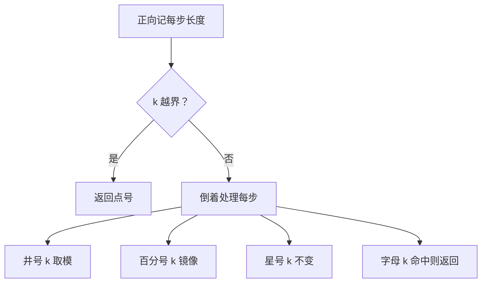

## Q
**LC 3614 用特殊操作处理字符串 II**｜Hard

字符串 `s` 由小写字母和 `*`、`#`、`%` 组成，从空串 `result` 开始依次处理：小写字母追加到末尾；`*` 删除末尾字符（空则不动）；`#` 把当前 `result` 复制一份接到后面；`%` 把 `result` 反转。给整数 `k`，返回最终 `result` 的第 `k` 个字符（从 `0` 起），`k` 越界返回 `'.'`。

## A
**一句话。** 长度会指数增长，不能真的拼；先正向记录每步之后的长度，再倒着走，把 `k` 逐步映射回上一状态：`#` 取模、`%` 取镜像、`*` 不变，遇到末尾追加的字母且 `k` 指向它就是答案。



```python
def process_str(s, k):
    lens, n = [], 0
    for c in s:
        if c == '*':
            n = max(n - 1, 0)
        elif c == '#':
            n *= 2
        elif c != '%':
            n += 1
        lens.append(n)
    if k >= n:
        return '.'
    for i in range(len(s) - 1, -1, -1):
        c = s[i]
        prev = lens[i - 1] if i else 0
        if c == '#':
            k %= prev               # 后一半是前一半的复制
        elif c == '%':
            k = lens[i] - 1 - k     # 反转后的镜像位置
        elif c != '*' and k == lens[i] - 1:
            return c                # 刚追加的字母就在位置 k
    return '.'
```

**复杂度。** 时间 `O(|s|)`，空间 `O(|s|)`。

**易错点。**
- 真的构造字符串：`#` 每次翻倍，长度可达 `2^|s|`。
- `*` 作用在空串上：长度保持 `0`，不能变负。
- 倒推 `*`：删去末尾字符不影响更前面的位置，`k` 不用改。

**追问。**
- 为什么 `#` 之后取模就够？：复制后位置 `k` 和 `k - prev` 的字符相同，所以 `k %= prev`。

**同模式。** LC 844 比较含退格的字符串、LC 1047 删除字符串中的所有相邻重复项、LC 3612 用特殊操作处理字符串 I
