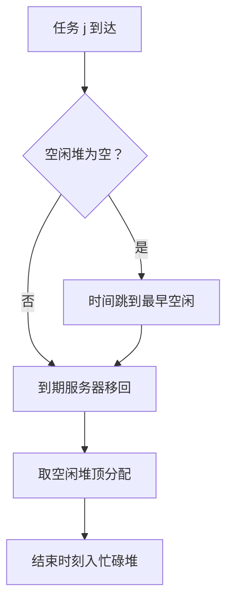

## Q
**LC 1882 使用服务器处理任务**｜Medium

`servers[i]` 是第 `i` 台服务器的权重，`tasks[j]` 是第 `j` 个任务的耗时。第 `j` 秒第 `j` 个任务入队；任务分配给**空闲且权重最小**的服务器（权重相同取下标小的），没有空闲服务器时等待最早空闲的。返回每个任务分配到的服务器下标。

## A
**一句话。** 两个堆：空闲堆按（权重，下标），忙碌堆按（空闲时刻，权重，下标）；当前时刻 `t` 推进后，把忙碌堆里到期的服务器移回空闲堆。



```python
def assigned_tasks(servers, tasks):
    free = [(w, i) for i, w in enumerate(servers)]
    heapify(free)
    busy = []                          # (空闲时刻, 权重, 下标)
    res, t = [], 0
    for j, d in enumerate(tasks):
        t = max(t, j)                  # 第 j 秒任务才入队
        if not free:
            t = max(t, busy[0][0])     # 都忙，跳到最早空闲
        while busy and busy[0][0] <= t:
            _, w, i = heappop(busy)
            heappush(free, (w, i))
        w, i = heappop(free)
        res.append(i)
        heappush(busy, (t + d, w, i))
    return res
```

**复杂度。** 时间 `O((n + m) log n)`，空间 `O(n)`。

**易错点。**
- 没有空闲时仍用 `t = j`：任务要等到有服务器空出来才开始，时间要跳过去。
- 到期的服务器只移回一台：同一时刻空闲的服务器要全部移回空闲堆，再按（权重，下标）选。

**追问。**
- 为什么时间可以直接跳？：没有空闲服务器时，中间没有事件发生，直接跳到最早空闲时刻即可。

**同模式。** LC 253 会议室 II、LC 1834 单线程 CPU、LC 2406 将区间分为最少组数、LC 2402 会议室 III
