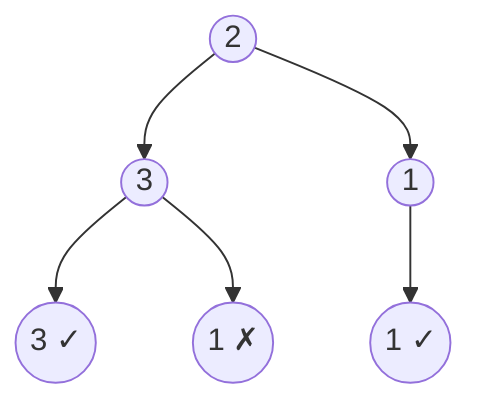

## Q
**LC 1457 二叉树中的伪回文路径**｜Medium

结点值为 1 到 9。若根到叶路径上的值重新排列后能成为回文，称为伪回文路径。求伪回文路径的条数。

## A
**一句话。** 能排成回文当且仅当至多一个数字出现奇数次；DFS 时用位掩码记每个数字出现次数的奇偶，到叶子检查掩码是否至多一位为 1（`mask & (mask - 1) == 0`）。

**图解。** 示例中三条路径：`2,3,3` 与 `2,1,1` 只有一个数字出现奇数次，是伪回文；`2,3,1` 有三个。



```python
def pseudo_palindromic_paths(root):
    def dfs(node, mask):
        if node is None:
            return 0
        mask ^= 1 << node.val      # 翻转该数字的奇偶位
        if node.left is None and node.right is None:
            return int(mask & (mask - 1) == 0)  # 至多一位奇数
        return dfs(node.left, mask) + dfs(node.right, mask)
    return dfs(root, 0)
```

**复杂度。** 时间 `O(n)`，空间 `O(h)`。

**易错点。**
- 在空结点处计数：一个孩子为空的结点会被当成路径终点，路径数多算。
- 判断条件写成 `mask == 0`：长度为奇数的路径允许一个数字出现奇数次。

**追问。**
- 为什么掩码不用回溯？：`mask` 是按值传递的整数，每层有自己的副本。
- 任意子路径呢？：变成「异或前缀相同或只差一位」的计数，配哈希表统计，类似 LC 2791。

**同模式。** LC 129 求根节点到叶节点数字之和、LC 112 路径总和、LC 266 回文排列
