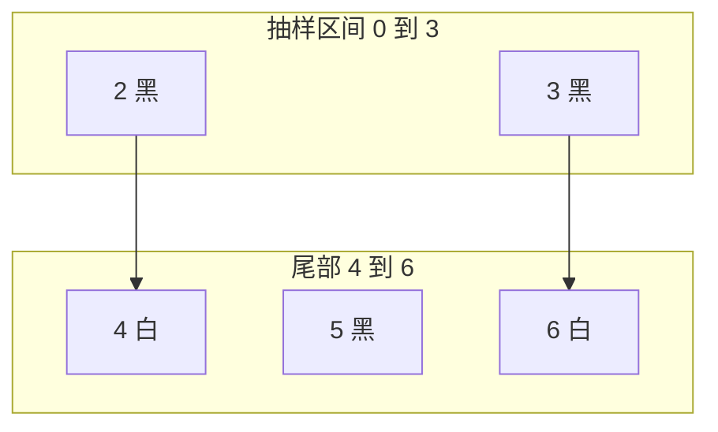

## Q
**LC 710 黑名单中的随机数**｜Hard

设计 `Solution(n, blacklist)`：`pick()` 从 `[0, n-1]` 中不在黑名单里的数中等概率随机返回一个，随机调用次数要尽量少。

## A
**一句话。** 白名单共 `m = n - len(blacklist)` 个，只在 `[0, m)` 里抽；落在黑名单的数映射到 `[m, n)` 里的白名单数。

**图解。** `n=7`，黑名单 `{2,3,5}`，`m=4`。`[0,4)` 里的黑名单数 2、3 依次映射到 `[4,7)` 里的白名单数 4、6，5 是黑名单，跳过。



```python
class Solution:
    def __init__(self, n, blacklist):
        self.m = n - len(blacklist)     # 白名单个数
        bad = set(blacklist)
        free = (x for x in range(self.m, n) if x not in bad)
        # [0,m) 里的黑名单数 -> [m,n) 里的白名单数
        self.map = {b: next(free) for b in blacklist
                    if b < self.m}

    def pick(self):
        x = random.randrange(self.m)
        return self.map.get(x, x)
```

**复杂度。** 时间 构造 `O(B)`，`pick` 为 `O(1)`，空间 `O(B)`（`B` 为黑名单长度）。

**易错点。**
- 映射目标选到黑名单数：尾部 `[m,n)` 里的黑名单数要先排除，用 `bad` 过滤。
- 把 `≥ m` 的黑名单数也放进映射：它们抽不到，多放只会让白名单数被白白占用。

**追问。**
- 为什么抽样区间长度刚好是 `m`？：白名单正好 `m` 个，`[0,m)` 里的白名单数映射给自己，其余一一对应尾部的白名单数，每个白名单数恰被覆盖一次，所以等概率。
- 黑名单很大时怎么办？：只存黑名单大小的映射，内存与 `n` 无关。

**同模式。** LC 528 按权重随机选择、LC 380 O(1) 时间插入、删除和获取随机元素、LC 398 随机数索引
