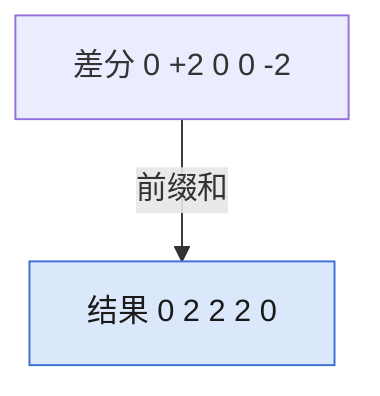

## Q
**LC 370 区间加法**｜Medium

长度为 `length` 的数组初始全 0。给若干更新 `[start, end, inc]`，表示把下标 `start..end`（闭区间）的元素都加上 `inc`。返回执行完所有更新后的数组。

## A
**一句话。** 差分数组：区间 `[l, r]` 加 `inc` 只改两个位置（`l` 处 `+inc`，`r+1` 处 `-inc`），最后做一次前缀和还原。

**图解。** `length=5`，更新 `[1,3,2]`：差分只动两处，前缀和后中间三格变 2。



```python
def get_modified_array(length, updates):
    diff = [0] * (length + 1)         # 多一格放 r+1
    for l, r, inc in updates:
        diff[l] += inc                # 从 l 起每格加
        diff[r + 1] -= inc            # 从 r+1 起撤销
    for i in range(1, length):
        diff[i] += diff[i - 1]        # 前缀和还原
    return diff[:length]
```

**复杂度。** 时间 `O(n + q)`，空间 `O(n)`。

**易错点。**
- 逐个更新每个区间的每个元素：`O(n·q)` 会超时，差分把每次更新降为 `O(1)`。
- `diff[r+1]` 越界：数组要开 `length + 1`，或判断 `r + 1 < length`。
- 前缀和从 0 开始：`diff[0]` 本身就是第 0 项，从 `1` 起累加。

**追问。**
- 为什么差分能区间更新？：差分的前缀和是原数组，改 `diff[l]` 让 `l` 之后所有项变，改 `diff[r+1]` 再把后面抵消。
- 查询和更新交替出现呢？：差分只适合先全部更新后统一查询，交替用树状数组或线段树。

**同模式。** LC 1109 航班预订统计、LC 1094 拼车、LC 2848 与车相交的点数、LC 303 区域和检索 - 数组不可变
