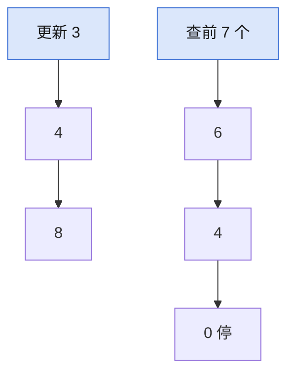

## Q
**LC 307 区域和检索 - 数组可修改**｜Medium

设计 `NumArray(nums)`：`update(index, val)` 把 `nums[index]` 改为 `val`，`sumRange(left, right)` 返回闭区间的和。

## A
**一句话。** 树状数组（Fenwick tree）：`t[i]` 管 `lowbit(i)` 个数，更新沿 `i += lowbit` 往上，前缀和沿 `i -= lowbit` 往下，都只走 `O(log n)` 步。

**图解。** `n = 8`：改下标 3（树状数组里是 3）走 3→4→8；查前 7 个走 7→6→4。



```python
class NumArray:
    def __init__(self, nums):
        self.n = len(nums)
        self.a = [0] * self.n          # 当前值，算差量用
        self.t = [0] * (self.n + 1)
        for i, v in enumerate(nums):
            self.update(i, v)

    def update(self, index, val):
        d, self.a[index] = val - self.a[index], val
        i = index + 1                  # 树状数组下标从 1 起
        while i <= self.n:
            self.t[i] += d
            i += i & -i

    def _pre(self, i):                 # 前 i 个数之和
        s = 0
        while i:
            s += self.t[i]
            i -= i & -i
        return s

    def sumRange(self, left, right):
        return self._pre(right + 1) - self._pre(left)
```

**复杂度。** 时间建树 `O(n log n)`、`update` 与 `sumRange` 各 `O(log n)`，空间 `O(n)`。

**易错点。**
- `update` 直接加 `val`：树里存的是和，要加的是新值减旧值的差量。
- 下标从 `0` 开始：`i & -i` 在 `0` 上永远是 `0`，更新会死循环。
- `sumRange` 写成 `_pre(right) - _pre(left)`：前缀函数收的是个数，闭区间要用 `right + 1` 与 `left`。

**追问。**
- 为什么不用前缀和数组？：它的更新是 `O(n)`；查询多更新少时前缀和更好，两者都多就用树状数组或线段树。
- 区间更新、区间查询呢？：用差分的两个树状数组，或带懒标记的线段树。

**同模式。** LC 303 区域和检索 - 数组不可变、LC 315 计算右侧小于当前元素的个数、LC 327 区间和的个数、LC 493 翻转对
