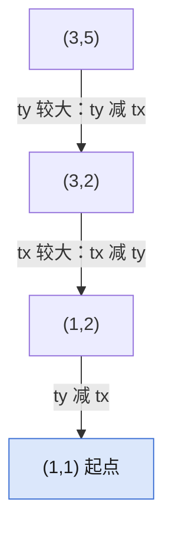

## Q
**LC 780 到达终点**｜Hard

一次操作可把点 `(x, y)` 变成 `(x+y, y)` 或 `(x, x+y)`。判断能否从 `(sx, sy)` 变成 `(tx, ty)`（所有坐标为正整数）。

## A
**一句话。** 从终点倒推：较大的坐标一定是由「较小的坐标加上若干次另一个」得到，倒推路径唯一，用取模一步减完。

**图解。** 终点 `(3,5)` 倒推：`5` 比 `3` 大，上一步是 `(3,2)`，再倒推 `(1,2)`、`(1,1)`，路径唯一。



```python
def reaching_points(sx, sy, tx, ty):
    while tx > sx and ty > sy and tx != ty:
        if tx > ty:
            tx %= ty            # 连续减 ty，一步取模
        else:
            ty %= tx
    if tx == sx and ty == sy:
        return True
    if tx == sx:                # x 到位：y 只能靠连续加 x
        return ty > sy and (ty - sy) % tx == 0
    if ty == sy:
        return tx > sx and (tx - sx) % ty == 0
    return False
```

**复杂度。** 时间 `O(log max(tx, ty))`，空间 `O(1)`。

**易错点。**
- 一次只减一个：数值到 `1e9` 会超时，用取模，类似辗转相除。
- 取模越过起点：`tx %= ty` 可能一步降到 `sx` 以下，循环条件用 `>`，退出后再用 `(tx - sx) % ty == 0` 判断能否恰好落在起点上。
- 取模得 `0`：`tx` 变成 `0`，后面的相等判断都不成立，自然返回 `False`，不用特判。

**追问。**
- 为什么倒推路径唯一？：正向有两种选择，但倒推时较大的坐标必然来自「减去较小的」，因为坐标都是正数。
- `tx == ty` 为什么停下？：前一步坐标会是 `0`，不合法。

**同模式。** LC 365 水壶问题、LC 1250 检查「好数组」、LC 1071 字符串的最大公因子
