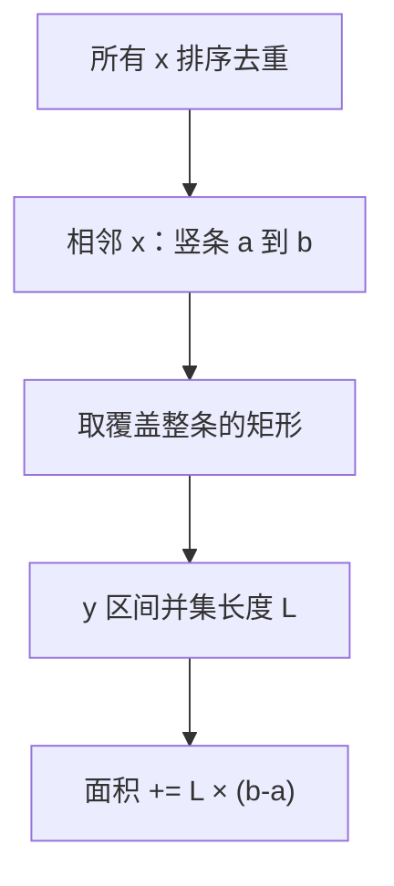

## Q
**LC 850 矩形面积 II**｜Hard

`rectangles[i] = [x1, y1, x2, y2]` 是轴对齐矩形的左下、右上坐标。求所有矩形并集的总面积，对 `1e9+7` 取模。

## A
**一句话。** 按所有 `x` 坐标把平面切成竖条，每条内覆盖它的矩形的 `y` 区间求并集长度，乘以条宽累加。

**图解。** 竖条宽度 = 相邻 `x`，高度 = 该条内 `y` 区间并集的长度；每个竖条的面积相加就是并集面积，重叠部分只算一次。



```python
def rectangle_area(rectangles):
    MOD = 10 ** 9 + 7
    xs = sorted({x for x1, _, x2, _ in rectangles
                 for x in (x1, x2)})
    area = 0
    for a, b in pairwise(xs):          # 竖条 [a, b]
        segs = sorted((y1, y2)
                      for x1, y1, x2, y2 in rectangles
                      if x1 <= a and b <= x2)
        cover = top = 0                # top：已算到的最高 y
        for y1, y2 in segs:
            y1 = max(y1, top)          # 去掉重叠的部分
            if y2 > y1:
                cover += y2 - y1
                top = y2
        area += cover * (b - a)
    return area % MOD
```

**复杂度。** 时间 `O(n² log n)`，空间 `O(n)`。

**易错点。**
- 直接累加所有矩形面积：重叠部分被算多次，必须按竖条去重。
- 每个竖条里 `y` 区间不去重：`segs` 里的区间会重叠，要用 `top` 截掉已覆盖的部分。
- 把坐标当格子逐个数：坐标可到 `1e9`，只能按离散化的竖条计算。

**追问。**
- 更快的做法？：扫描线 + 线段树，按 `x` 排序事件，线段树维护 `y` 轴被覆盖的总长度，`O(n log n)`。
- 为什么按 `x` 切条？：竖条内部的覆盖情况处处相同，把二维并集变成一维区间并集。

**同模式。** LC 223 矩形面积、LC 218 天际线问题、LC 56 合并区间
