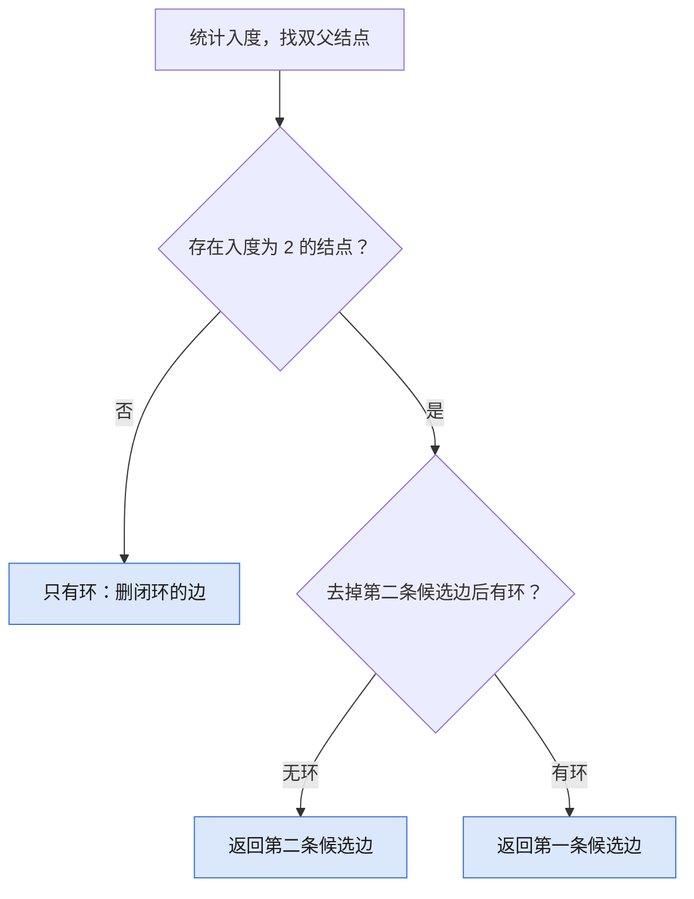

## Q
**LC 685 冗余连接 II**｜Hard

有根树是只有一个根、其余每个结点恰有一个父结点的有向图。现在给一棵有根树上额外加了一条有向边后的边列表（结点 `1..n`）。返回一条可以删去、使剩下的图恢复成有根树的边；有多个答案时返回最后出现的那条。

## A
**一句话。** 多出一条边只有两种症状：某结点有两个父亲，或出现了环。先找入度为 2 的结点的两条候选边，再用并查集（去掉第二条候选）检查是否有环，据此决定删哪条。

**图解。** 三种情形：只有环则删环上最后一条边；有双父结点且无环则删第二条；有双父结点且有环则删第一条。



```python
def find_redundant_directed_connection(edges):
    n = len(edges)
    parent = [0] * (n + 1)
    cand1 = cand2 = None
    for u, v in edges:
        if parent[v]:                # v 已有父亲，出现双父
            cand1, cand2 = [parent[v], v], [u, v]
        else:
            parent[v] = u
    fa = list(range(n + 1))
    def find(x):
        while fa[x] != x:
            fa[x] = fa[fa[x]]
            x = fa[x]
        return x
    for u, v in edges:
        if [u, v] == cand2:
            continue                 # 先假设删掉第二条候选
        ru, rv = find(u), find(v)
        if ru == rv:                 # 仍然成环
            return cand1 if cand2 else [u, v]
        fa[rv] = ru
    return cand2
```

**复杂度。** 时间 `O(n α(n))`，空间 `O(n)`。

**易错点。**
- 把它当作 LC 684 无向版：有向图要分「双父」和「环」两种情形，直接并查集会错删。
- 第二条候选边也写进 `parent`：应只记录第一条，第二条留作候选，之后并查集跳过它。
- 双父且有环时返回第二条：此时第二条删掉后环仍在，说明环上的是第一条候选，应删第一条。

**追问。**
- 为什么先试删第二条？：题目要返回最后出现的，若删它能消除问题，就是答案。
- 能不能只用 DFS？：可以，对每条候选边试删后检查是否是有根树，`O(n)` 次检查，总共仍是 `O(n)`（只有至多 2 条候选）。

**同模式。** LC 684 冗余连接（Redundant Connection）、LC 261 Graph Valid Tree、LC 1319 连通网络的操作次数、LC 947 移除最多的同行或同列石头
