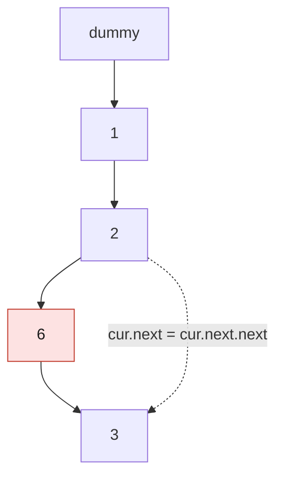

## Q
**LC 203 移除链表元素**｜Easy

给链表头节点 `head` 和整数 `val`，删除所有值等于 `val` 的节点，返回新的头节点。

## A
**一句话。** 在头前加一个哑节点（dummy），这样头节点和其他节点删法一致：看 `cur.next` 要不要删，要删就跳过它。

**图解。** 删掉 `6`：`cur` 停在 `2`，把 `2.next` 指向 `3`。



```python
def remove_elements(head, val):
    dummy = ListNode(0, head)
    cur = dummy
    while cur.next:
        if cur.next.val == val:
            cur.next = cur.next.next   # 跳过它，cur 不动
        else:
            cur = cur.next
    return dummy.next
```

**复杂度。** 时间 `O(n)`，空间 `O(1)`。

**易错点。**
- 删除后还往前走一步：`1→6→6→3` 连续两个 `6` 会漏删第二个，删除时 `cur` 要停在原地。
- 头节点就要删：没有哑节点就要单独写一段循环，返回 `dummy.next` 就统一了。
- 判断 `cur.val` 而不是 `cur.next.val`：到了要删的节点才发现，已无法改前驱的指针。

**追问。**
- 递归写法？：`head.next = remove(head.next, val)`，返回 `head.next if head.val == val else head`，简洁但栈深 `O(n)`。
- 只给要删的节点本身（没有头）怎么办？：把下一个节点的值拷贝过来，再跳过下一个节点，见 LC 237。

**同模式。** LC 237 删除链表中的节点、LC 83 删除排序链表中的重复元素、LC 82 删除排序链表中的重复元素 II、LC 19 删除链表的倒数第 N 个结点
