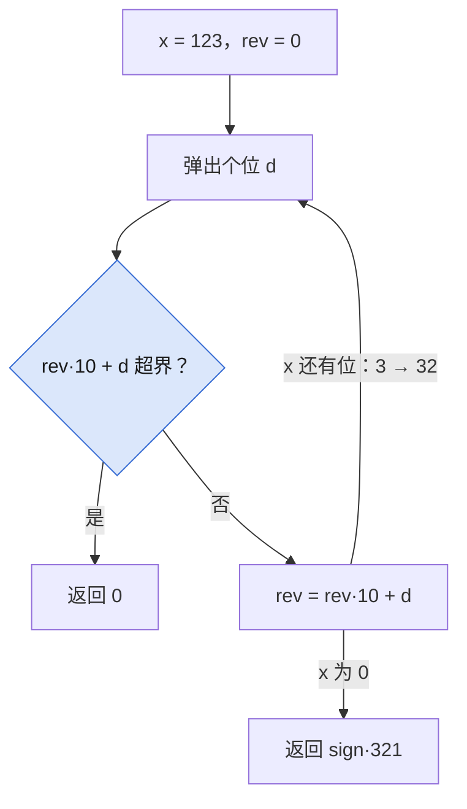

## Q
**LC 7 整数反转**｜Medium

反转 32 位有符号整数 `x` 的数字，反转后超出 `[-2^31, 2^31-1]` 返回 `0`（不能存 64 位）。

## A
**一句话。** 逐位取个位接到结果末尾，接之前先判断这一步会不会溢出。

**图解。** 每接一位前先判断会不会超界，超界直接返回 `0`。



```python
def reverse(x):
    sign = -1 if x < 0 else 1
    x = abs(x)               # Python 的 // 对负数向下取整，先取绝对值
    limit = 2**31 - 1 if sign == 1 else 2**31
    rev = 0
    while x:
        x, d = divmod(x, 10)
        if rev > (limit - d) // 10:   # rev*10 + d 会超界
            return 0
        rev = rev * 10 + d
    return sign * rev
```

**复杂度。** 时间 `O(log x)`，空间 `O(1)`。

**易错点。**
- 对负数直接 `x //= 10`：`-1 // 10 == -1`，永远到不了 `0`，死循环。
- 忘了溢出检查：`1534236469` 应返回 `0`，Python 会给出 `9646324351`。
- 负数下界当成 `2^31 - 1`：`-2^31` 的绝对值比正数上界大 `1`。

**追问。**
- 只能用 32 位整型怎么判溢出？：接之前比较 `rev > INT_MAX // 10`（或相等且 `d > 7`）。

**同模式。** LC 9 回文数、LC 8 字符串转换整数、LC 66 加一、LC 2 两数相加
