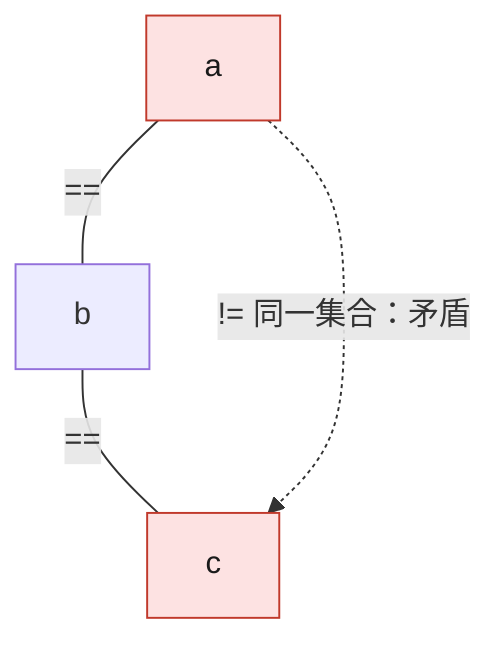

## Q
**LC 990 等式方程的可满足性**｜Medium

字符串数组里每条方程形如 `"a==b"` 或 `"a!=b"`（变量是小写字母）。判断能否给变量赋整数值，使所有方程同时成立。

## A
**一句话。** 并查集：先把所有 `==` 的两个变量并到一起，再检查每条 `!=` 的两端是否落在同一个集合里。

**图解。** `a==b`、`b==c` 把三者并成一组，`a!=c` 两端同组，矛盾。



```python
def equations_possible(equations):
    parent = list(range(26))
    def find(x):
        while parent[x] != x:
            parent[x] = parent[parent[x]]   # 路径折半
            x = parent[x]
        return x
    for e in equations:                     # 先处理全部 ==
        a, b = ord(e[0]) - 97, ord(e[3]) - 97
        if e[1] == '=':
            parent[find(a)] = find(b)
    for e in equations:                     # 再检查 !=
        a, b = ord(e[0]) - 97, ord(e[3]) - 97
        if e[1] == '!' and find(a) == find(b):
            return False
    return True
```

**复杂度。** 时间 `O(N·α(26))`，空间 `O(26)`。

**易错点。**
- 边读边判断 `!=`：`a!=c` 在 `a==b`、`b==c` 之前出现时会漏判，必须两遍，先并后查。
- 用 `e[1]` 区分后又取错下标：形如 `a==b` 与 `a!=b`，变量在下标 `0` 和 `3`，下标 `1` 是 `=` 或 `!`。
- `a!=a`：同一变量必同集，会被第二遍抓出，不用特判。

**追问。**
- 为什么两遍？：`==` 是传递的，等价类要先完整建好，`!=` 才是对它的约束检查。
- 变量不止 26 个呢？：用字典做并查集，键是变量名。

**同模式。** LC 721 账户合并、LC 399 除法求值、LC 547 省份数量、LC 1202 交换字符串中的元素
