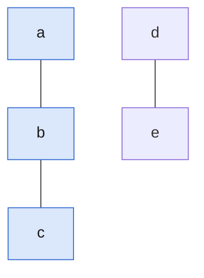

## Q
**LC 737 句子相似性 II**｜Medium

两个句子是单词数组，再给相似单词对 `similarPairs`。相似关系**可传递**；两句相似当且仅当长度相同，且对应位置的单词相似（或相同）。

## A
**一句话。** 并查集：先把相似对合并成连通块，再逐位比较两个单词是否同根。

**图解。** `a~b`、`b~c` 合并后 `a` 与 `c` 同根，所以相似；`d` 在另一块。



```python
def are_sentences_similar_two(s1, s2, pairs):
    if len(s1) != len(s2):
        return False
    parent = {}
    def find(x):
        parent.setdefault(x, x)
        if parent[x] != x:
            parent[x] = find(parent[x])   # 路径压缩
        return parent[x]
    for a, b in pairs:
        parent[find(a)] = find(b)
    return all(find(a) == find(b) for a, b in zip(s1, s2))
```

**复杂度。** 时间 `O((n + p) α)`，空间 `O(p)`。

**易错点。**
- 没出现在相似对里的单词：`find` 里用 `setdefault` 自动成为自己的根，相同单词才判相似。
- 只按相似对直接查：传递性要靠并查集，`a~b`、`b~c` 时 `a` 与 `c` 也相似。

**追问。**
- 为什么不用 DFS？：并查集在线合并，查询近似 `O(1)`，不用先建图。

**同模式。** LC 734 句子相似性、LC 721 账户合并、LC 990 等式方程的可满足性
