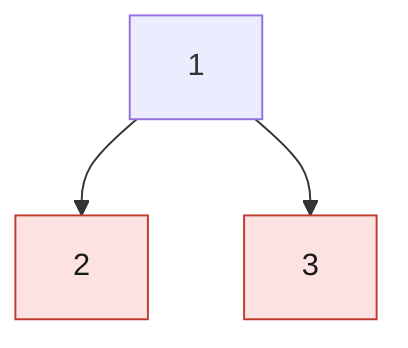

## Q
**LC 444 序列重建**｜Medium

`nums` 是 `1..n` 的一个排列，`sequences` 是若干 `nums` 的子序列。判断 `nums` 是否是 `sequences` 唯一的最短超序列（即能由这些子序列确定出的唯一顺序）。

## A
**一句话。** 每个子序列里相邻的两个数定下先后，建有向图做拓扑排序；顺序唯一当且仅当每一步队列里恰好有一个入度为 0 的点，并且它正是 `nums` 的下一个。

**图解。** `sequences = [[1,2],[1,3]]`：1 之后 2 和 3 同时入度为 0，先后不定，所以不唯一。



```python
def sequence_reconstruction(nums, sequences):
    n = len(nums)
    g = [[] for _ in range(n + 1)]
    indeg = [0] * (n + 1)
    for seq in sequences:
        for a, b in zip(seq, seq[1:]):  # 相邻两个数定先后
            g[a].append(b)
            indeg[b] += 1
    q = [i for i in range(1, n + 1) if indeg[i] == 0]
    for x in nums:                     # 拓扑序必须唯一且等于 nums
        if len(q) != 1 or q[0] != x:
            return False
        u = q.pop()
        for v in g[u]:
            indeg[v] -= 1
            if indeg[v] == 0:
                q.append(v)
    return True
```

**复杂度。** 时间 `O(n + 所有序列长度和)`，空间 `O(n + 边数)`。

**易错点。**
- 只检查能得到 `nums` 的一种拓扑序：要保证唯一，所以每步队列长度必须恰为 1。
- 只比较第一个入度 0 的点：要和 `nums` 当前下标的数逐个比对，顺序也要对。
- 孤立的点：没出现在任何序列里的数入度为 0，会使队列里同时多于一个点，正好判成不唯一。

**追问。**
- 为什么相邻两个数就够了？：序列里更远的先后关系可由相邻关系传递推出。
- 和课程表 II 的区别？：那里要任意一个合法顺序，这里要判断顺序是否唯一。

**同模式。** LC 207 课程表、LC 210 课程表 II、LC 269 火星词典、LC 310 最小高度树
