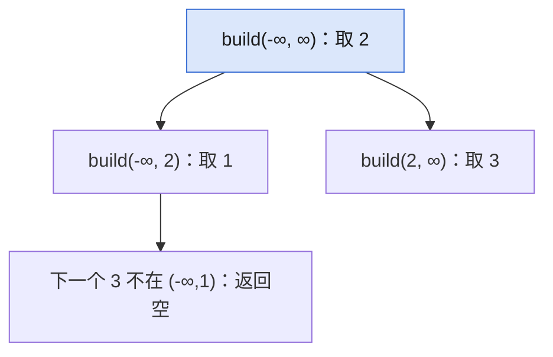

## Q
**LC 449 序列化和反序列化二叉搜索树**｜Medium

设计 `Codec`：`serialize(root)` 把二叉搜索树变成字符串，`deserialize(data)` 还原出同一棵树，编码越短越好。

## A
**一句话。** 只存前序值，不存空指针；还原时靠 BST 的上下界判断下一个数属于哪棵子树。

**图解。** 前序 `2,1,3`：根取 2；左子树范围 `(-∞,2)` 收下 1；右子树范围 `(2,∞)` 收下 3。



```python
class Codec:
    def serialize(self, root):
        res = []
        def dfs(node):
            if node:
                res.append(str(node.val))   # 前序
                dfs(node.left)
                dfs(node.right)
        dfs(root)
        return ','.join(res)

    def deserialize(self, data):
        vals = deque(int(x) for x in data.split(',') if x)
        def build(lo, hi):          # 下一个值须落在 (lo, hi)
            if not vals or not lo < vals[0] < hi:
                return None
            v = vals.popleft()
            node = TreeNode(v)
            node.left = build(lo, v)
            node.right = build(v, hi)
            return node
        return build(float('-inf'), float('inf'))
```

**复杂度。** 时间 `O(n)`，空间 `O(n)`。

**易错点。**
- 先建右子树：前序是「根、左、右」，必须先左后右，顺序反了值会被错分。
- 空树：序列化得空串，`split` 后是 `['']`，转 `int` 会报错，要先判空。
- 上界用 `<=`：BST 值不重复，开区间即可；若允许重复就要约定重复值放哪一边。

**追问。**
- 为什么普通二叉树做不到？：缺少上下界约束，必须记录空指针（`#`）才能唯一还原。
- 换成后序行吗？：可以，反向读取，先建右再建左，其余同理。

**同模式。** LC 297 二叉树的序列化与反序列化、LC 1008 前序遍历构造二叉搜索树、LC 428 序列化和反序列化 N 叉树
