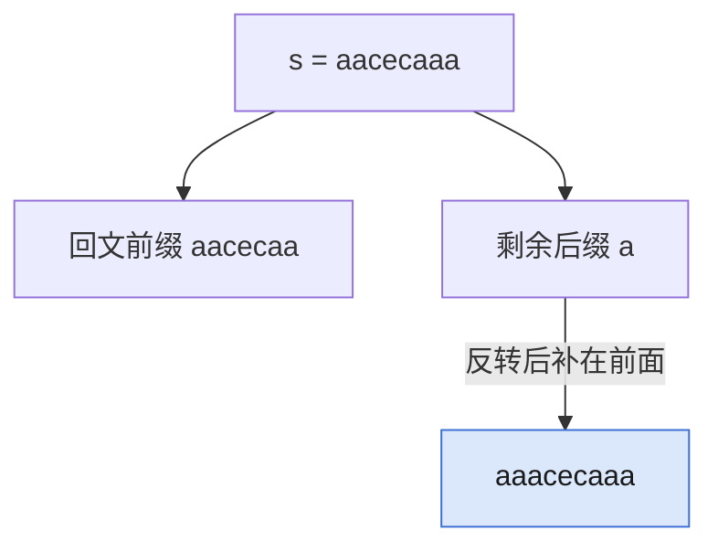

## Q
**LC 214 最短回文串**｜Hard

只能在字符串 `s` 的前面添加字符，求能得到的最短回文串。

## A
**一句话。** 问题等价于求 `s` 的最长回文前缀：对 `s + '#' + 反转(s)` 跑 KMP 前缀函数，末位的值就是最长回文前缀的长度，剩下的后缀反转后补到前面。

**图解。** `s = aacecaaa`：最长回文前缀 `aacecaa`，剩余 `a`，把它反转补到最前面。



```python
def shortest_palindrome(s):
    t = s + '#' + s[::-1]
    fail = [0] * len(t)                # KMP 前缀函数
    for i in range(1, len(t)):
        k = fail[i - 1]
        while k and t[i] != t[k]:
            k = fail[k - 1]
        if t[i] == t[k]:
            k += 1
        fail[i] = k
    return s[fail[-1]:][::-1] + s      # fail[-1]：最长回文前缀长度
```

**复杂度。** 时间 `O(n)`，空间 `O(n)`。

**易错点。**
- 不加分隔符 `#`：`s` 与反转串拼起来后，前缀函数可能跨过拼接处，匹配长度超过 `len(s)`。
- 把最长回文子串当成最长回文前缀：前缀必须从开头开始，补的字符才是最少的。
- 补错一侧：补在前面的是被剩下后缀的反转，不是前缀的反转。

**追问。**
- 为什么前缀函数给出的是回文前缀？：`s` 的前缀等于反转串的后缀，即该前缀读反了仍等于自己，所以是回文。
- 用哈希怎么做？：滚动哈希同时算前缀的正向哈希与反向哈希，相等的最长前缀就是答案，`O(n)`。

**同模式。** LC 5 最长回文子串、LC 28 找出字符串中第一个匹配项的下标、LC 459 重复的子字符串、LC 647 回文子串
