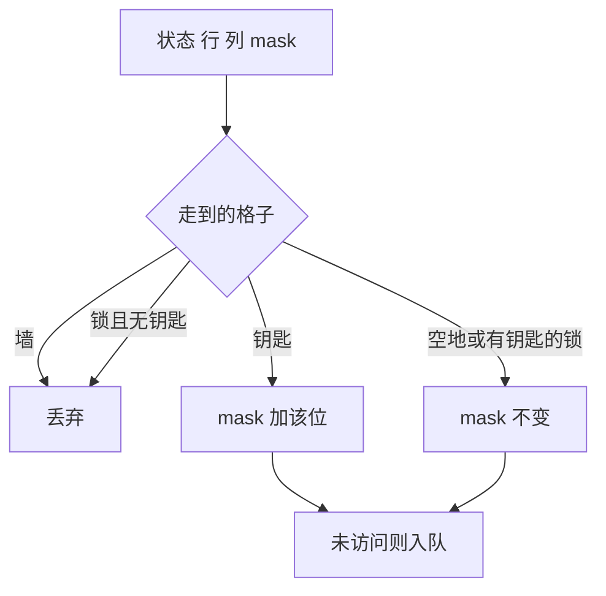

## Q
**LC 864 获取所有钥匙的最短路径**｜Hard

网格中 `@` 是起点，`.` 空地，`#` 墙，小写字母是钥匙，大写字母是对应的锁（有钥匙才能通过）。每步走一格，返回拿到所有钥匙的最少步数，做不到返回 `-1`。

## A
**一句话。** BFS 的状态是 `(行, 列, 已有钥匙的位掩码)`，同一格带着不同钥匙集合视为不同状态。

**图解。** 钥匙是状态的一部分：同一个格子，钥匙集合不同就是不同结点；遇到大写字母要查掩码里有没有对应的位。



```python
def shortest_path_all_keys(grid):
    m, n = len(grid), len(grid[0])
    keys = 0
    for i in range(m):
        for j in range(n):
            if grid[i][j] == "@":
                si, sj = i, j
            elif grid[i][j].islower():
                keys += 1
    full = (1 << keys) - 1
    q, seen = deque([(si, sj, 0)]), {(si, sj, 0)}
    step = 0
    while q:
        for _ in range(len(q)):
            i, j, mask = q.popleft()
            if mask == full:
                return step
            for x, y in ((i+1, j), (i-1, j),
                         (i, j+1), (i, j-1)):
                if not (0 <= x < m and 0 <= y < n):
                    continue
                c = grid[x][y]
                if c == "#":
                    continue
                if c.isupper() and not (
                        mask >> (ord(c) - 65)) & 1:
                    continue           # 没有对应的钥匙
                nm = mask
                if c.islower():
                    nm |= 1 << (ord(c) - 97)
                if (x, y, nm) not in seen:
                    seen.add((x, y, nm))
                    q.append((x, y, nm))
        step += 1
    return -1
```

**复杂度。** 时间 `O(mn·2^k)`，空间 `O(mn·2^k)`（`k ≤ 6` 为钥匙数）。

**易错点。**
- 访问标记只按 `(行, 列)`：带着不同钥匙回到同一格是有意义的，状态必须含掩码。
- 掩码位对不上：钥匙恰为前 `k` 个字母，`a` 是第 0 位，大写字母用 `ord(c) - 65` 对应同一位。
- 步数多算一层：在取出结点时判断 `mask == full`，此时的 `step` 才是到达它的步数。

**追问。**
- 状态数多大？：`m·n·2^k`，`k ≤ 6` 时只有几万个，BFS 足够。
- 大写字母处为什么不直接拿钥匙？：锁不会给钥匙，只有小写字母更新掩码。

**同模式。** LC 1293 网格中的最短路径、LC 847 访问所有节点的最短路径、LC 773 滑动谜题
