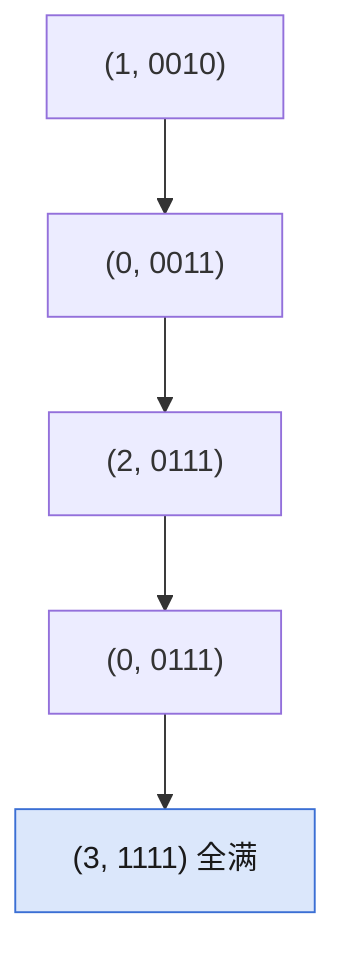

## Q
**LC 847 访问所有节点的最短路径**｜Hard

`n` 个节点的无向连通图用邻接表 `graph` 给出。可从任意点出发、可重复经过点和边，返回访问所有节点的最短路径长度。

## A
**一句话。** 状态是（当前节点，已访问集合的位掩码），从所有起点同时做 BFS，第一个掩码全满的状态所在层数即答案。

**图解。** 星形图 `0` 连 `1 2 3`：从 1 出发，回到 0 再去 2，回到 0 再去 3，共 4 步。



```python
def shortest_path_length(graph):
    n = len(graph)
    full = (1 << n) - 1
    q = [(i, 1 << i) for i in range(n)]   # 每个点都可作起点
    seen = set(q)
    step = 0
    while q:
        nq = []
        for u, mask in q:
            if mask == full:
                return step
            for v in graph[u]:
                s = (v, mask | 1 << v)
                if s not in seen:      # 同一状态只走一次
                    seen.add(s)
                    nq.append(s)
        q, step = nq, step + 1
```

**复杂度。** 时间 `O(n·2ⁿ·度数)`，空间 `O(n·2ⁿ)`。

**易错点。**
- 状态只记节点：同一节点带着不同的已访问集合，后续能走的路不同，必须带掩码。
- 单起点 BFS：最优路径的起点未知，要把所有 `(i, 1<<i)` 一起放进初始队列。
- `seen` 缺失：图有环，没有它会无限循环，状态数上界是 `n·2ⁿ`。

**追问。**
- 为什么不用 DFS？：要最短步数，BFS 按层扩展，首次满掩码就是最短。
- 也可以怎么做？：状态压缩 DP `dp[mask][u]` 加松弛，或 Floyd 求全源最短路后做旅行商 DP。

**同模式。** LC 943 最短超级串、LC 1125 最小的必要团队、LC 1129 颜色交替的最短路径
