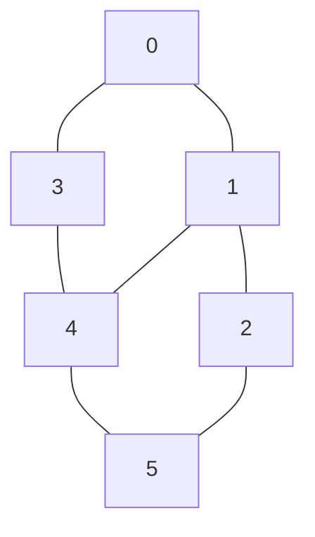

## Q
**LC 773 滑动谜题**｜Hard

`2×3` 的板上有 `0~5`，`0` 是空格，每步可把空格与上下左右的数交换。求变成 `[[1,2,3],[4,5,0]]` 的最少步数，无解返回 `-1`。

## A
**一句话。** 把板压成 6 位字符串当状态，查表得到空格的邻居，做 BFS，一层一步。

**图解。** 格子按 0~5 编号，空格在哪个格子就只能和图上相连的格子交换。



```python
NB = [(1, 3), (0, 2, 4), (1, 5), (0, 4), (1, 3, 5), (2, 4)]

def sliding_puzzle(board):
    s = ''.join(str(x) for row in board for x in row)
    goal, seen, q, step = '123450', {s}, [s], 0
    while q:
        nq = []
        for s in q:                  # 一层 = 一步
            if s == goal:
                return step
            z = s.index('0')
            for j in NB[z]:          # 空格与邻格交换
                t = list(s)
                t[z], t[j] = t[j], t[z]
                t = ''.join(t)
                if t not in seen:
                    seen.add(t)
                    nq.append(t)
        q, step = nq, step + 1
    return -1
```

**复杂度。** 时间 `O(6!·6)`，空间 `O(6!)`（一共 720 种状态，一半可达）。

**易错点。**
- 邻接表写错：`2×3` 里下标 2 和 3 不相邻（换行处），一格 `+1` 会穿过行。
- 忘了 `seen`：状态有环，BFS 会无限重复。
- 起点就是目标：`step = 0` 要在出队时判断，别漏。

**追问。**
- 怎么提前判无解？：看逆序数的奇偶，奇偶不同的状态互不可达，BFS 前 `O(1)` 返回 `-1`。
- 想更快？：双向 BFS，或者 A* 加曼哈顿距离启发式。

**同模式。** LC 752 打开转盘锁、LC 127 单词接龙、LC 433 最小基因变化、LC 994 腐烂的橘子
