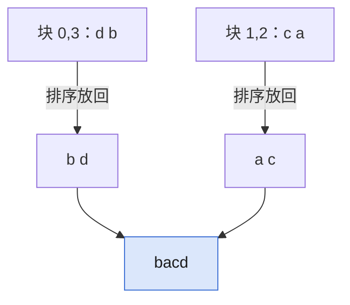

## Q
**LC 1202 交换字符串中的元素**｜Medium

给字符串 `s` 和下标对数组 `pairs`，每个 `[a, b]` 表示可以任意多次交换 `s[a]` 与 `s[b]`。返回能得到的字典序最小的字符串。

## A
**一句话。** 并查集把可互换的下标并成连通块，每块内部的字符可以任意排列，所以每块的字符排好序放回该块的下标（下标也升序）。

**图解。** `s = dcab`，`pairs = [[0,3],[1,2]]`：块 `{0,3}` 的 `d,b` 排成 `b,d`，块 `{1,2}` 的 `c,a` 排成 `a,c`，得 `bacd`。



```python
def smallest_string_with_swaps(s, pairs):
    parent = list(range(len(s)))
    def find(x):
        while parent[x] != x:
            parent[x] = parent[parent[x]]
            x = parent[x]
        return x
    for a, b in pairs:
        parent[find(a)] = find(b)
    groups = defaultdict(list)
    for i in range(len(s)):
        groups[find(i)].append(i)      # 下标按升序收集
    res = list(s)
    for idx in groups.values():
        chars = sorted(s[i] for i in idx)
        for i, c in zip(idx, chars):   # 小字符放小下标
            res[i] = c
    return ''.join(res)
```

**复杂度。** 时间 `O(n log n + m·α)`，空间 `O(n)`。

**易错点。**
- 只对相邻下标排序：交换可以传递，`[0,1]` 与 `[1,2]` 让 `0` 和 `2` 也能互换，必须按连通块。
- 字符排了序但下标没升序：`groups` 里的下标按循环顺序收集，天然升序，若来自 `set` 就要先排序。
- 把整个字符串排序：不同连通块之间不能换，只能块内排序。

**追问。**
- 为什么块内任意排列都能达到？：同块内任意两个下标由一串相邻交换连接，交换集合能生成块内的全部排列。
- 也可以怎么建块？：图遍历（DFS/BFS）也行，并查集更短。

**同模式。** LC 721 账户合并、LC 990 等式方程的可满足性、LC 947 移除最多的同行或同列石头、LC 1319 连通网络的操作次数
