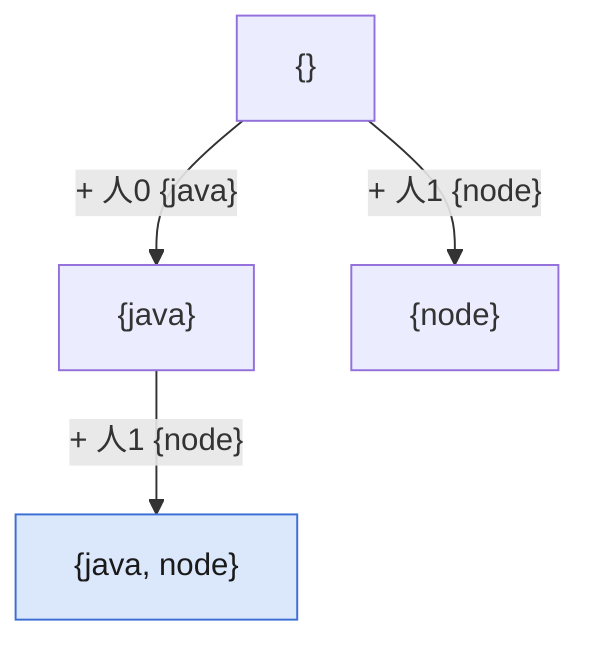

## Q
**LC 1125 最小的必要团队**｜Hard

`req_skills` 是项目需要的技能（至多 16 种），`people[i]` 是第 `i` 个人会的技能列表。选出人数最少的团队使所有技能都被覆盖，返回人员下标（任一方案即可）。

## A
**一句话。** 把已覆盖的技能集合压成位掩码，状态 `dp[mask]` 是覆盖 `mask` 的最小团队；依次考虑每个人，把他加进已有状态得到更大的集合。

**图解。** 每加入一个人，已有状态 `mask` 变成 `mask | 他的技能`，只在团队更小时覆盖旧值。



```python
def smallest_sufficient_team(req_skills, people):
    idx = {s: i for i, s in enumerate(req_skills)}
    full = (1 << len(req_skills)) - 1
    dp = {0: []}                  # 技能掩码 -> 最小团队
    for i, skills in enumerate(people):
        me = 0
        for s in skills:
            me |= 1 << idx[s]
        for mask, team in list(dp.items()):   # 先拍快照
            new, size = mask | me, len(team) + 1
            if new not in dp or len(dp[new]) > size:
                dp[new] = team + [i]
    return dp[full]
```

**复杂度。** 时间 `O(n · 2^m)`（`m` 为技能数），空间 `O(2^m · n)`。

**易错点。**
- 遍历 `dp` 的同时往里加：字典大小改变会报错，要遍历 `list(dp.items())` 的快照。
- 同一个人用两次：快照保证每个人在一轮里只加一次。
- 只记团队大小：要还原方案，必须存人员列表。

**追问。**
- 为什么不按技能枚举？：人数最多 60，技能最多 16，对技能做状态压缩更小。
- 想只存大小再回溯？：另开 `pre[mask] = (上一个 mask, 人)`，最后沿链还原。

**同模式。** LC 691 贴纸拼词、LC 1349 参加考试的最大学生数、LC 698 划分为k个相等的子集、LC 847 访问所有节点的最短路径
