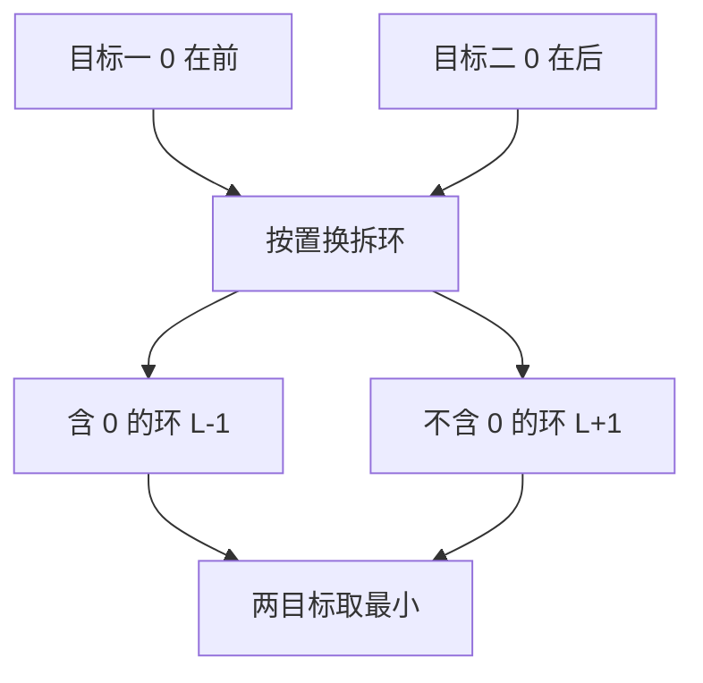

## Q
**LC 2459 通过移动项目到空白区域来排序数组**｜Hard

`0` 到 `n-1` 的排列 `nums`，其中 `0` 表示空位。每次可以把任意一个数移动到空位（即与 `0` 交换）。求把数组变成升序（`0` 在最前，或 `0` 在最后）所需的最少操作数。

## A
**一句话。** 对每个目标排列做置换环分解：不含 `0` 的环（长度 `L ≥ 2`）需要 `L + 1` 步，含 `0` 的环需要 `L - 1` 步；两个目标取较小的。



```python
def sort_array(nums):
    n = len(nums)

    def cost(shift):                 # shift 0：0 在前；1：0 在后
        seen = [False] * n
        ops = 0
        for i in range(n):
            if seen[i]:
                continue
            j, length, has0 = i, 0, False
            while not seen[j]:
                seen[j] = True
                length += 1
                has0 = has0 or nums[j] == 0
                j = (nums[j] - shift) % n   # 这个数应去的位置
            if length > 1:
                ops += length - 1 if has0 else length + 1
        return ops

    return min(cost(0), cost(1))
```

**复杂度。** 时间 `O(n)`，空间 `O(n)`。

**易错点。**
- 只算一个目标：升序的两种摆法都要试。
- 不含 `0` 的环也按 `L - 1`：它得先借空位，多一步，再还一步，共 `L + 1`。
- 长度为 `1` 的环：已在位，不计步数。

**追问。**
- 为什么含 `0` 的环是 `L - 1`？：每次把 `0` 的目标位置上应有的数移进来，每步归位一个数，最后 `0` 自然归位。

**同模式。** LC 2471 逐层排序二叉树所需的最少操作数目、LC 765 情侣牵手、LC 41 缺失的第一个正数
