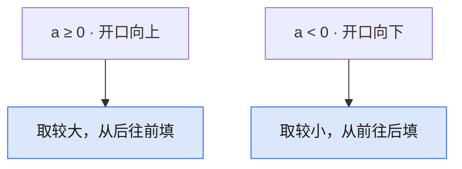

## Q
**LC 360 有序转化数组**｜Medium

升序整数数组 `nums` 和整数 `a`、`b`、`c`。对每个 `x` 计算 `f(x) = a·x² + b·x + c`，返回按升序排列的结果。

## A
**一句话。** `f` 是抛物线：`a ≥ 0` 时开口向上，两端的值最大；`a < 0` 时开口向下，两端的值最小。双指针从两端向中间，每次取较大（或较小）的那个填进结果。

**图解。** 开口向上时最大值一定在两端，从后往前填；开口向下时最小值在两端，从前往后填。



```python
def sort_transformed_array(nums, a, b, c):
    f = lambda x: a * x * x + b * x + c
    n = len(nums)
    res = [0] * n
    l, r = 0, n - 1
    idx = n - 1 if a >= 0 else 0
    step = -1 if a >= 0 else 1
    while l <= r:
        fl, fr = f(nums[l]), f(nums[r])
        if (fl > fr) == (a >= 0):     # 取两端中更靠外的值
            res[idx] = fl
            l += 1
        else:
            res[idx] = fr
            r -= 1
        idx += step
    return res
```

**复杂度。** 时间 `O(n)`，空间 `O(n)`（输出）。

**易错点。**
- 当 `a < 0` 时仍然从后往前填：开口向下时端点最小，应从前往后填。
- `a = 0` 时：函数是直线，按 `a >= 0` 处理，较大的端点仍在某一端。
- 先全部算出来再排序：`O(n log n)`，题目希望利用有序性做到线性。

**追问。**
- 抛物线的最低点在哪里？：`x = -b / (2a)`，也可以先二分找到离最低点最近的位置再向两边合并，同样线性。
- 为什么两端值能决定最大值？：抛物线在对称轴两侧单调，数组有序，所以极值总在数组两端之一。

**同模式。** LC 977 有序数组的平方、LC 88 合并两个有序数组、LC 167 两数之和 II - 输入有序数组、LC 11 盛最多水的容器
