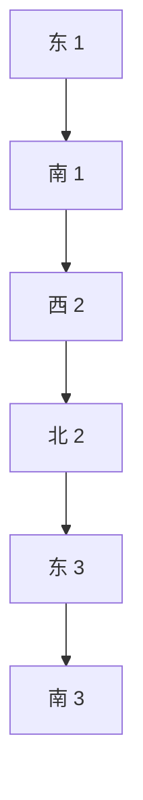

## Q
**LC 885 螺旋矩阵 III**｜Medium

在 `rows × cols` 的网格里，从 `(rStart, cStart)` 面朝东出发，按顺时针螺旋向外走，返回依次经过的、在网格内的所有格子坐标。

## A
**一句话。** 螺旋的步长是 `1, 1, 2, 2, 3, 3, …`：每个步长走两个方向（东南、西北依次旋转），走出网格的点不记，直到收齐所有格子。

**图解。** 方向按东、南、西、北轮转，每走完两个方向步长加一。



```python
def spiral_matrix_iii(rows, cols, rStart, cStart):
    res = [[rStart, cStart]]
    r, c, step, d = rStart, cStart, 1, 0
    dirs = ((0, 1), (1, 0), (0, -1), (-1, 0))  # 东 南 西 北
    while len(res) < rows * cols:
        for _ in range(2):             # 每个步长走两个方向
            dr, dc = dirs[d % 4]
            for _ in range(step):
                r, c = r + dr, c + dc
                if 0 <= r < rows and 0 <= c < cols:
                    res.append([r, c])  # 界外的路过但不记
            d += 1
        step += 1
    return res
```

**复杂度。** 时间 `O(max(rows, cols)²)`，空间 `O(1)`（不计返回值）。

**易错点。**
- 走到界外就停：螺旋可能暂时出界后再回来，要继续走，只是不记录。
- 步长每转一个方向就加一：应是每转两个方向加一，`1,1,2,2,3,3`。
- 方向顺序错：要顺时针，东、南、西、北。

**追问。**
- 循环为什么一定会结束？：螺旋越走越大，最终覆盖整个网格，每个格子只记录一次，收齐 `rows*cols` 个就停。
- 从外向内的螺旋矩阵怎么做？：用上下左右四条边界收缩，见螺旋矩阵 I、II。

**同模式。** LC 54 螺旋矩阵、LC 59 螺旋矩阵 II、LC 2326 螺旋矩阵 IV、LC 874 模拟行走机器人
