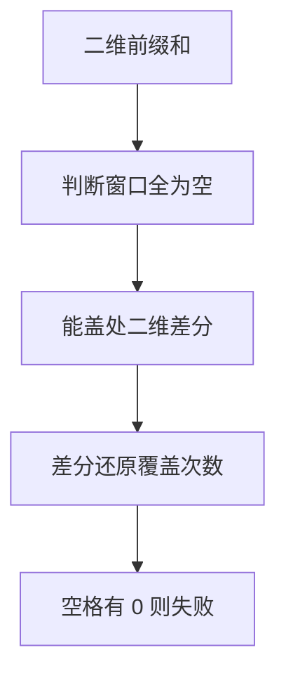

## Q
**LC 2132 用邮票贴满网格图**｜Hard

`m x n` 的 0/1 网格（`1` 被占用）和邮票尺寸 `stampHeight × stampWidth`。邮票只能盖在全是空格（`0`）的位置，可以重叠，不能旋转，不能超出网格。问能否用若干张邮票盖满所有空格。

## A
**一句话。** 二维前缀和判断每个位置能否盖章，再用二维差分把所有能盖的位置的覆盖区间累加，检查是否每个空格都被至少一张覆盖。



```python
def possible_to_stamp(grid, h, w):
    m, n = len(grid), len(grid[0])
    s = [[0] * (n + 1) for _ in range(m + 1)]
    for i in range(m):
        for j in range(n):
            s[i+1][j+1] = (s[i][j+1] + s[i+1][j]
                           - s[i][j] + grid[i][j])
    d = [[0] * (n + 1) for _ in range(m + 1)]
    for i in range(h, m + 1):              # 右下角在 (i-1, j-1)
        for j in range(w, n + 1):
            tot = s[i][j] - s[i-h][j] - s[i][j-w] + s[i-h][j-w]
            if tot == 0:
                d[i-h][j-w] += 1
                d[i-h][j] -= 1
                d[i][j-w] -= 1
                d[i][j] += 1
    c = [[0] * (n + 1) for _ in range(m + 1)]
    for i in range(m):
        for j in range(n):
            c[i+1][j+1] = (c[i][j+1] + c[i+1][j]
                           - c[i][j] + d[i][j])
            if grid[i][j] == 0 and c[i+1][j+1] == 0:
                return False
    return True
```

**复杂度。** 时间 `O(mn)`，空间 `O(mn)`。

**易错点。**
- 对每个空格暴力检查邮票：`O(mnhw)` 会超时，前缀和把判断压到 `O(1)`。
- 差分四角下标写错：区间是左闭右开，`(i-h, j-w)` 起、`(i, j)` 止。
- 把已被占用的格也要求覆盖：只有 `grid == 0` 的格必须被覆盖。

**追问。**
- 为什么贪心地盖所有能盖的位置就行？：多盖不会遮住任何空格也不会盖到障碍，覆盖集合只增不减。

**同模式。** LC 73 矩阵置零、LC 48 旋转图像、LC 304 二维区域和检索 - 矩阵不可变
