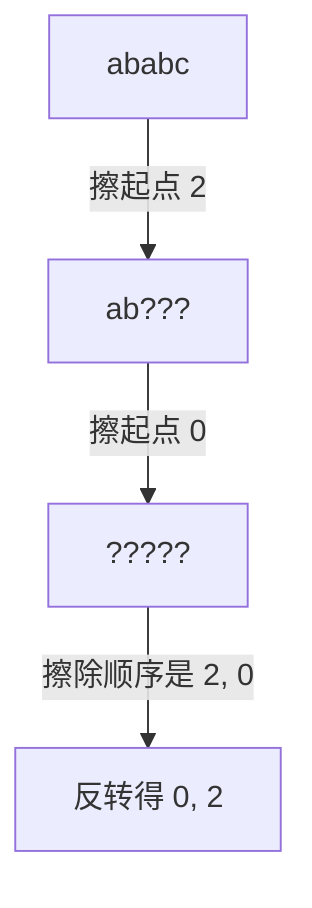

## Q
**LC 936 戳印序列**｜Hard

有长为 `n` 的全 `?` 串。每次把 `stamp` 整体盖在某个起点（盖住的字符被覆盖成 `stamp` 的字母）。给 `target`，返回把 `?` 串变成 `target` 的起点序列（至多 `10n` 次），做不到返回 `[]`。

## A
**一句话。** 倒着做：每次在 `target` 里找一个能「擦掉」的窗口（字符匹配 `stamp` 或已是 `?`，且至少有一个真字符），擦成 `?`；全擦完后把擦除顺序反转。

**图解。** `stamp = abc`、`target = ababc`：先擦起点 2（最后盖上的 `abc`），再擦起点 0（后三位已是 `?`，当通配符）。盖章顺序与擦除顺序相反。



```python
def moves_to_stamp(stamp, target):
    m, n = len(stamp), len(target)
    t, ans = list(target), []
    def can(i):                      # 窗口 i 能被擦掉吗
        hit = False
        for k in range(m):
            if t[i + k] == "?":
                continue             # 已擦：通配
            if t[i + k] != stamp[k]:
                return False
            hit = True
        return hit                   # 至少擦掉一个真字符
    changed = True
    while changed:
        changed = False
        for i in range(n - m + 1):
            if can(i):
                t[i:i + m] = "?" * m
                ans.append(i)
                changed = True
    return ans[::-1] if set(t) == {"?"} else []
```

**复杂度。** 时间 `O(n²m)`，空间 `O(n)`。

**易错点。**
- 正着盖：后盖的会盖掉前面，无法判断先后；倒着擦时最后一次盖章的窗口必须完整匹配 `stamp`，容易确定。
- 窗口全是 `?` 也当作能擦：会无限循环，必须要求至少有一个真字符。
- 忘了反转：擦除顺序和盖章顺序相反。

**追问。**
- 为什么擦除步数不会超过 `10n`？：每次至少擦掉一个新字符，最多 `n` 次。
- 为什么贪心擦的顺序不影响可行性？：擦成 `?` 只会让别的窗口更容易匹配，不会让它们变难。

**同模式。** LC 854 相似度为 K 的字符串、LC 943 最短超级串
