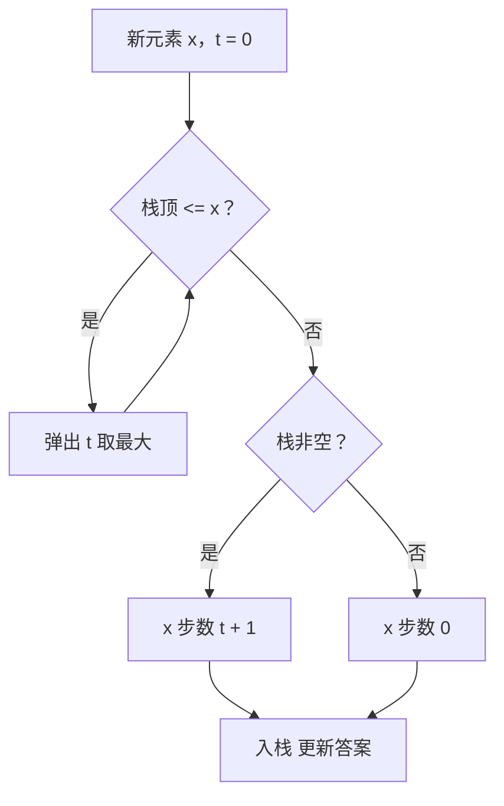

## Q
**LC 2289 使数组按非递减顺序排列**｜Medium

整数数组 `nums`。每一步同时删除所有满足 `nums[i - 1] > nums[i]` 的元素 `nums[i]`。求数组变为非递减所需的步数。

## A
**一句话。** 单调栈：每个元素被删除的步数，等于它左边被它"吃掉"的那些更小或相等元素里最大的步数再加 `1`；若左边没有更大的元素，则永远不会被删（步数 `0`）。



```python
def total_steps(nums):
    ans = 0
    st = []                          # (值, 被删除所需步数)，值严格递减
    for x in nums:
        t = 0
        while st and st[-1][0] <= x:
            t = max(t, st.pop()[1])  # 弹出的元素先于 x 被前面的大数删掉
        t = t + 1 if st else 0       # 左边有更大的数，x 才会被删
        st.append((x, t))
        ans = max(ans, t)
    return ans
```

**复杂度。** 时间 `O(n)`，空间 `O(n)`。

**易错点。**
- 栈空时仍加 `1`：左边没有比 `x` 大的元素，`x` 永远不会被删，步数是 `0`。
- 弹出条件用 `<`：相等的元素不会删除彼此，但它们之前的步数要被继承，用 `<=` 才对。

**追问。**
- 直接模拟为什么慢？：每步要扫一遍数组，最多 `n` 步，`O(n²)`。

**同模式。** LC 945 使数组唯一的最小增量操作、LC 665 非递减数列、LC 1944 队列中可以看到的人数
