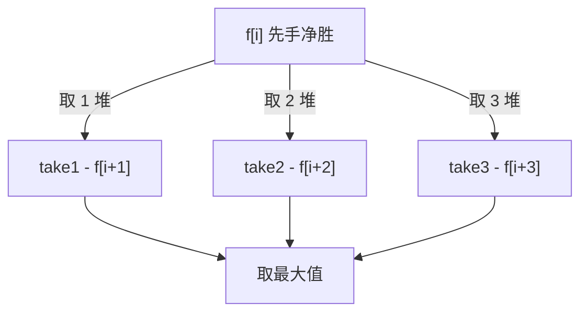

## Q
**LC 1406 石子游戏 III**｜Hard

`stoneValue` 排成一行，Alice 和 Bob 轮流（Alice 先手），每次从最前面取 `1`、`2` 或 `3` 堆，得分是取走的石子价值之和。都以最优策略，谁总分高谁赢，相同为平局。返回 `"Alice"`、`"Bob"` 或 `"Tie"`。

## A
**一句话。** `f[i]` 是从第 `i` 堆开始先手比后手多拿的分数：取走 `k` 堆后轮到对手，`f[i] = max(取走的和 - f[i+k])`。

**图解。** 先手取走 `k` 堆得到 `take`，之后对手在剩余局面里比自己多拿 `f[i+k]`，所以净分是 `take - f[i+k]`，取 `k = 1, 2, 3` 的最大者。



```python
def stone_game_iii(stone_value):
    n = len(stone_value)
    f = [0] * (n + 1)                # f[i]：从 i 起先手净胜分
    for i in range(n - 1, -1, -1):
        take, f[i] = 0, -inf
        for k in range(i, min(i + 3, n)):
            take += stone_value[k]
            f[i] = max(f[i], take - f[k + 1])   # 取完轮到对手
    if f[0] > 0:
        return "Alice"
    return "Bob" if f[0] < 0 else "Tie"
```

**复杂度。** 时间 `O(n)`，空间 `O(n)`。

**易错点。**
- 记两个人各自的分数：状态翻倍；两人最优时只需「当前先手的净胜分」。
- 用 `+ f[i+k]`：下一步轮到对手，他的净胜分对自己是负的，必须减。
- 初始 `f[i]` 写 `0`：取值可能全为负，最大值要从 `-inf` 起步。

**追问。**
- 为什么净胜分的递推和博弈对称？：零和游戏中，一方的收益恰是另一方的损失，只需一个状态变量。
- 石子游戏 II（LC 1140）怎么变？：每次可取的堆数随上一次变化，状态多一维 `M`。

**同模式。** LC 877 石子游戏、LC 1140 石子游戏 II、LC 486 预测赢家
