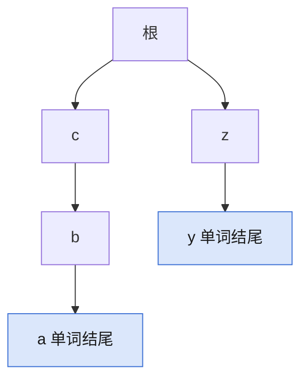

## Q
**LC 1032 字符流**｜Hard

设计 `StreamChecker(words)`：`query(letter)` 接收下一个字符，若已读入的字符流的某个后缀恰好是 `words` 中的某个单词则返回 `true`。

## A
**一句话。** 把单词反向插入字典树，查询时从最新字符往前走，一旦路过单词结尾就命中；只回看最长单词那么多字符。

**图解。** 单词 `abc` 反向插入：`c → b → a`。流是 `...xabc`，最新字符 `c` 开始往回走，依次命中 `c`、`b`、`a` 并遇到结尾标记，返回 `true`。



```python
class StreamChecker:
    def __init__(self, words):
        self.trie = {}
        for w in words:
            node = self.trie
            for c in reversed(w):       # 反向插入：对准后缀
                node = node.setdefault(c, {})
            node["#"] = True            # 单词结尾标记
        self.s = []
        self.m = max(map(len, words))   # 最多回看这么多字符

    def query(self, letter):
        self.s.append(letter)
        node = self.trie
        for c in reversed(self.s[-self.m:]):
            if c not in node:
                return False
            node = node[c]
            if "#" in node:
                return True
        return False
```

**复杂度。** 时间 构造 `O(Σ|w|)`，`query` 为 `O(m)`，空间 `O(Σ|w| + 流长度)`。

**易错点。**
- 正向插入单词：流在不停增长，起点不固定，只有末尾（后缀）是固定的，所以要反向匹配。
- 遇到结尾标记不返回：路径上任何位置的结尾标记都表示某个单词是后缀。
- 回看整个流：只需回看最长单词的长度，超过的部分不可能匹配。

**追问。**
- 为什么不用 Aho-Corasick？：它可以做到均摊 `O(1)`，但构造失配指针较重，反向 Trie 已够通过。
- 流很长时内存怎么办？：只保留最后 `m` 个字符，用定长队列。

**同模式。** LC 208 实现 Trie (前缀树)、LC 211 添加与搜索单词、LC 1408 数组中的字符串匹配
