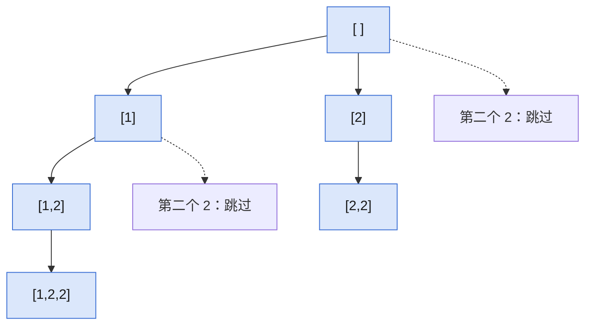

## Q
**LC 90 子集 II**｜Medium

数组 `nums` 可能含重复元素，返回所有不重复的子集（幂集）。

## A
**一句话。** 排序后回溯，同一层循环里相同的数只选第一个，每个子集恰好生成一次。

**图解。** 回溯树里每个节点都是一个子集；同一层的第二个 `2` 被跳过（虚线），所以不会重复。



```python
def subsets_with_dup(nums):
    nums.sort()                    # 相同的数相邻，才能同层去重
    res, path = [], []

    def dfs(start):
        res.append(path[:])        # 每个节点就是一个子集
        for i in range(start, len(nums)):
            if i > start and nums[i] == nums[i - 1]:
                continue           # 同层重复，跳过
            path.append(nums[i])
            dfs(i + 1)
            path.pop()

    dfs(0)
    return res
```

**复杂度。** 时间 `O(n·2^n)`，空间 `O(n)`。

**易错点。**
- 去重条件写成 `i > 0`：`[1,2,2]` 漏掉 `[1,2,2]` 和 `[2,2]`，要用 `i > start`。
- 忘了排序：`[2,1,2]` 生成 8 个子集，其中有重复。
- `res.append(path)` 不拷贝：最后所有结果指向同一个清空的列表。

**追问。**
- 不用递归怎么写？：按值分组，每个值出现 `c` 次，就把已有子集各追加 `1..c` 个该值。
- 只数个数怎么算？：各值出现次数加一的乘积，`[1,2,2]` 是 `2*3=6`。

**同模式。** LC 78 子集、LC 40 组合总和 II、LC 47 全排列 II、LC 491 非递减子序列
