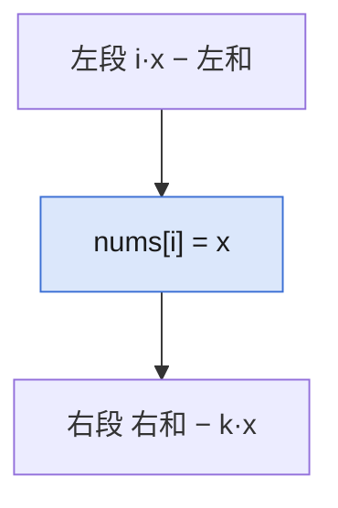

## Q
**LC 1685 有序数组中差绝对值之和**｜Medium

非递减数组 `nums`。返回数组 `result`，`result[i]` 等于 `nums[i]` 与数组中所有其他元素之差的绝对值之和。

## A
**一句话。** 数组有序，所以左边的数都不大于 `nums[i]`、右边的都不小于它；用前缀和分别算左右两段，去绝对值。

**图解。** 对下标 `i`：左边 `i` 个数各比它小，贡献 `i·x - 左和`；右边 `k = n-i-1` 个数各比它大，贡献 `右和 - k·x`。



```python
def get_sum_absolute_differences(nums):
    n, total, left = len(nums), sum(nums), 0
    res = []
    for i, x in enumerate(nums):
        right = total - left - x         # 右边所有数之和
        res.append(x * i - left + right - x * (n - i - 1))
        left += x
    return res
```

**复杂度。** 时间 `O(n)`，空间 `O(1)`（不计输出）。

**易错点。**
- 把 `x` 自己算进左段或右段：差为 0 但会让和多一个 `x`。
- 忘了数组必须有序：无序时要先排序并记下原下标。

**追问。**
- 数组无序且有多个查询值怎么办？：排序加前缀和，每个查询二分找分界点，即 LC 2602。
- 二维或带权版本？：同样按维度排序，前缀和换成带权前缀和。

**同模式。** LC 2602 使数组元素全部相等的最少操作次数、LC 238 除了自身以外数组的乘积
