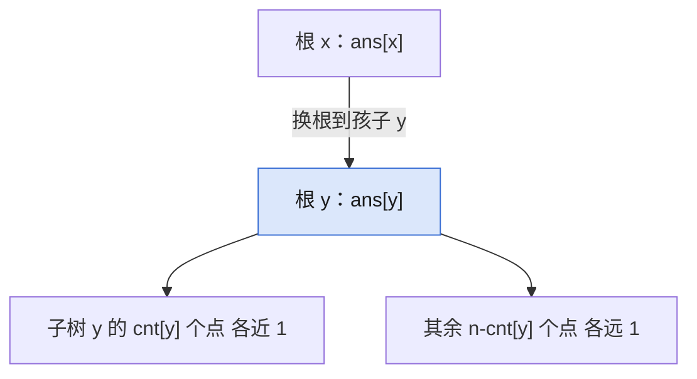

## Q
**LC 834 树中距离之和**｜Hard

给 `n` 个节点的无向树（边列表 `edges`）。返回数组 `ans`，`ans[i]` 是节点 `i` 到其他所有节点的距离之和。

## A
**一句话。** 换根 DP：先以 0 为根算出 `ans[0]` 和各子树大小，再把根从 `x` 挪到孩子 `y`，用子树大小直接推 `ans[y]`。

**图解。** 根从 `x` 挪到 `y`：`y` 子树里 `cnt[y]` 个点各近 1，其余 `n-cnt[y]` 个点各远 1。



```python
def sum_of_distances_in_tree(n, edges):
    g = [[] for _ in range(n)]
    for a, b in edges:
        g[a].append(b)
        g[b].append(a)
    cnt = [1] * n                   # 子树大小
    ans = [0] * n
    def dfs1(x, p):                 # 以 0 为根：ans[x] 先只算子树内
        for y in g[x]:
            if y != p:
                dfs1(y, x)
                cnt[x] += cnt[y]
                ans[x] += ans[y] + cnt[y]
    def dfs2(x, p):                 # 换根
        for y in g[x]:
            if y != p:
                ans[y] = ans[x] + n - 2 * cnt[y]
                dfs2(y, x)
    dfs1(0, -1)
    dfs2(0, -1)
    return ans
```

**复杂度。** 时间 `O(n)`，空间 `O(n)`。

**易错点。**
- 换根公式写反：`y` 子树里的点近 1，所以减 `cnt[y]`，其余加 `n - cnt[y]`，合起来是 `+ n - 2·cnt[y]`。
- 在 `dfs2` 里更新 `cnt`：换根公式始终用以 0 为根时的子树大小，不要改它。
- 对每个点各做一次 DFS：`O(n²)` 会超时，要靠换根复用。

**追问。**
- 换根 DP 的通用步骤？：先任选一个根算出子树信息，再自上而下，用父亲的答案扣掉孩子子树的贡献、补上其余部分，得到孩子作根的答案。
- 求每个点作根的树高呢？：同一套路，要记最大和次大的子树深度。

**同模式。** LC 310 最小高度树、LC 2858 可以到达每一个节点的最少边反转次数、LC 543 二叉树的直径
