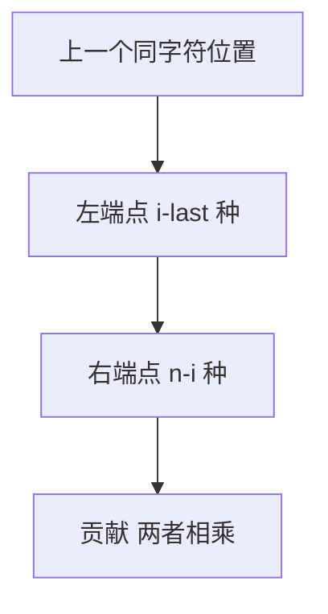

## Q
**LC 2262 字符串的总引力**｜Hard

字符串的"引力"是其中不同字符的个数。求 `s` 所有子串的引力之和。

## A
**一句话。** 按字符贡献：位置 `i` 的字符 `c` 只在"右端点 ≥ i、左端点 > 上一个 `c` 的位置"时贡献 1，共 `(i - last[c]) × (n - i)` 个子串。



```python
def appeal_sum(s):
    n = len(s)
    last = {}                              # 字符 -> 上次出现的下标
    ans = 0
    for i, c in enumerate(s):
        ans += (i - last.get(c, -1)) * (n - i)
        last[c] = i
    return ans
```

**复杂度。** 时间 `O(n)`，空间 `O(26)`。

**易错点。**
- 左端点把上一个同字符包含进来：该字符会被重复计数，左端点必须在 `last` 之后。
- `last` 初值用 `0`：应是 `-1`，才能让第一次出现时左端点有 `i + 1` 种。

**追问。**
- 为什么这样不重复？：每个子串里每种字符，只在它的第一次出现处计数一次。

**同模式。** LC 2063 所有子字符串中的元音、LC 907 子数组的最小值之和、LC 2104 子数组范围和、LC 992 K 个不同整数的子数组
