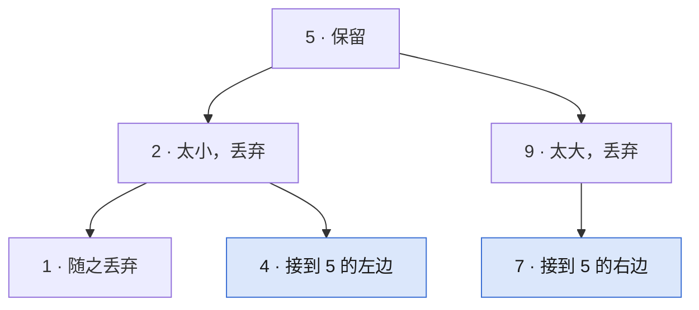

## Q
**LC 669 修剪二叉搜索树**｜Medium

给 BST 的根结点和区间 `[low, high]`，删去所有不在区间内的结点，保持剩余结点的相对结构，返回新的根。

## A
**一句话。** 结点太小就整棵左子树作废、答案在右子树；太大则反之；在区间内才保留并分别修剪左右。

**图解。** 区间 `[3, 8]`：`2` 太小，它自己和左子树整个丢掉，用修剪后的右子树顶替它的位置。



```python
def trim_bst(root, low, high):
    if not root:
        return None
    if root.val < low:           # 自己和左子树都太小
        return trim_bst(root.right, low, high)
    if root.val > high:          # 自己和右子树都太大
        return trim_bst(root.left, low, high)
    root.left = trim_bst(root.left, low, high)
    root.right = trim_bst(root.right, low, high)
    return root
```

**复杂度。** 时间 `O(n)`，空间 `O(h)`。

**易错点。**
- `root.val < low` 时仍递归左子树：左边全比它小，必然也在区间外。
- 保留的结点忘了重新接上两边的返回值：被替换的子树不会挂回来。

**追问。**
- 能降到 `O(h)` 吗？：先沿路径找到第一个落在区间内的结点作新根，再分别沿左右边界修剪，只访问边界上的结点。
- 区间内结点的结构会变吗？：不会，只是被丢弃结点的子树顶上来。

**同模式。** LC 450 删除二叉搜索树中的节点、LC 700 二叉搜索树中的搜索、LC 98 验证二叉搜索树、LC 1382 将二叉搜索树变平衡
