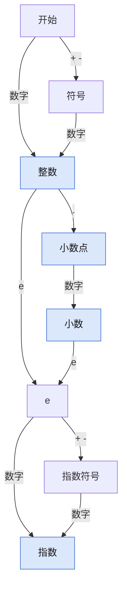

## Q
**LC 65 有效数字**｜Hard

判断字符串 `s` 是否是有效数字：可带正负号的整数或小数（如 `2`、`-0.1`、`.5`、`4.`），其后可跟 `e`/`E` 与带符号的整数指数（如 `2e10`、`-90E3`）。

## A
**一句话。** 一次扫描，用几个标志记状态：见过数字、见过小数点、见过 `e`；符号只能在开头或 `e` 后，`e` 后必须再来数字。

**图解。** 有限状态机：蓝底是可以结束的状态。



```python
def is_number(s):
    digit = dot = exp = False
    for i, c in enumerate(s):
        if c.isdigit():
            digit = True
        elif c in '+-':
            if i > 0 and s[i - 1] not in 'eE':
                return False           # 符号只在开头或 e 后
        elif c == '.':
            if dot or exp:
                return False           # 一个点，且不能在 e 后
            dot = True
        elif c in 'eE':
            if exp or not digit:
                return False           # 一个 e，且前面要有数字
            exp, digit = True, False   # e 后还要新数字
        else:
            return False
    return digit
```

**复杂度。** 时间 `O(n)`，空间 `O(1)`。

**易错点。**
- `e` 后没有数字：`"4e"`、`"4e+"` 无效，遇到 `e` 要把「见过数字」清零，结尾才能判断。
- `"."` 单独出现：点前后都没有数字，`digit` 为假，应返回 `False`。
- `"4."` 与 `".5"` 都有效：只要整串有数字即可，点两侧不必都有。

**追问。**
- 想让规则更清晰？：画出有限状态机（见图），写成状态转移表，面试官常要这种写法。
- 用正则怎么写？：`^[+-]?(\d+\.?\d*|\.\d+)([eE][+-]?\d+)?$`。

**同模式。** LC 8 字符串转换整数 (atoi)、LC 468 验证IP地址、LC 224 基本计算器、LC 227 基本计算器 II
