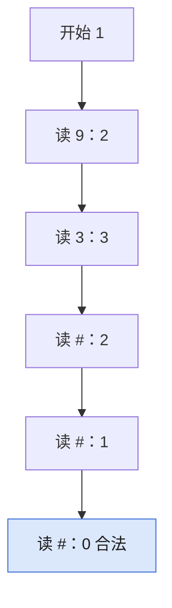

## Q
**LC 331 验证二叉树的前序序列化**｜Medium

前序序列化里用 `#` 表示空节点，如 `"9,3,4,#,#,1,#,#,2,#,6,#,#"`。不重建树，判断给定字符串是否是某棵二叉树合法的前序序列化。

## A
**一句话。** 数「槽位」：开始有 1 个空位待填，读一个节点占一个位置，非空节点再带来两个新位置；任何时候位置不够就非法，读完恰好填满才合法。

**图解。** 对 `9,3,#,#,#`（根 9，左子 3，右为空），每读一个节点后剩余槽位依次是：



```python
def is_valid_serialization(preorder):
    slots = 1                          # 待填的位置数
    for x in preorder.split(','):
        if slots == 0:
            return False               # 树已满，还有节点
        slots -= 1                     # 占一个位置
        if x != '#':
            slots += 2                 # 非空节点：多出左右两个位置
    return slots == 0
```

**复杂度。** 时间 `O(n)`，空间 `O(n)`（`split` 的结果）。

**易错点。**
- 读完才检查：中途 `slots` 变 0 说明树已经完整，后面再来节点就非法，要在读每个节点前判断。
- 终点只判断 `slots >= 0`：必须恰好为 `0`，否则还有位置没填。
- 把 `#` 也加 2：`#` 只占位不产生新位置。

**追问。**
- 也可以怎么想？：每个非空节点出度 2、入度 1，空节点入度 1、出度 0，合法当且仅当总入度等于总出度加 1，且中途不为负。
- 用栈怎么做？：遇 `#` 就把栈顶的「`数字 #` 对」折叠成 `#`，最后栈里只剩一个 `#`。

**同模式。** LC 297 二叉树的序列化与反序列化、LC 428 序列化和反序列化 N 叉树、LC 255 验证前序遍历序列二叉搜索树、LC 449 序列化和反序列化二叉搜索树
